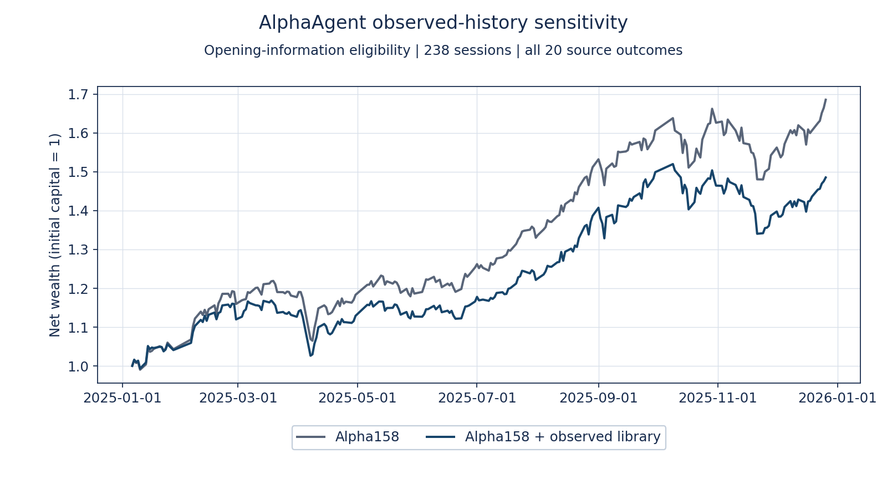
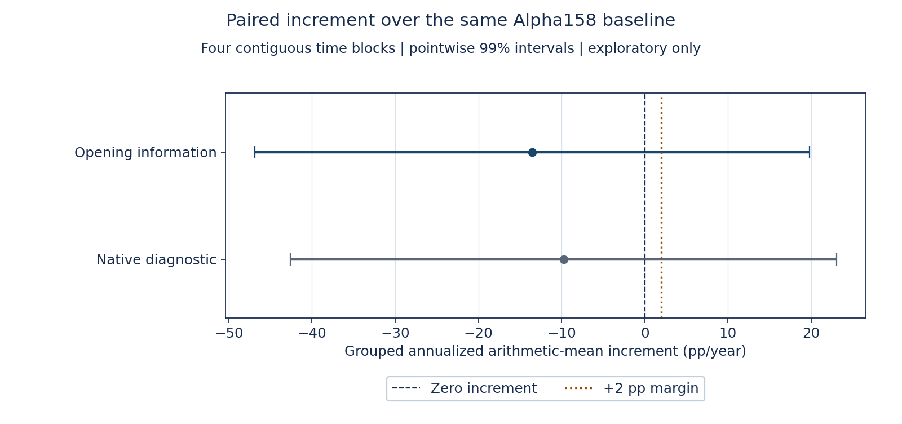

# AlphaAgent: all20 observed-history sensitivity

The observed library changes the full-sample annualized mean net return by -13.557 percentage points relative to Alpha158 under opening-information eligibility. The grouped pointwise99% interval is [-46.893, 19.782]pp/year, with descriptive raw p=0.098061.

The pointwise interval includes zero and includes the +2pp/year margin. Equivalence within the stated margin is not established; a positive2pp effect is not ruled out. These are conditional exploratory statements.

This is the separately declared exploratory comparison conditional on all20 realized source outcomes and their mixed attempt budgets. The original strict20-by5 primary is unavailable because trials12/14 ended early. This result cannot replace that primary or enter the original four-primary/54-secondary families. No confirmatory or project-family significance claim is made.

## Net wealth under opening information



| Arm | Ending wealth | Cumulative return |
|---|---|---|
| Alpha158 | 1.685229 | +68.523% |
| Alpha158 + observed library | 1.485240 | +48.524% |

[Full performance audit](visual_tables/performance_full_audit.csv). Both paths use the exact same238-session calendar, January6–December26,2025, native fees/lots/portfolio settings and initial capital. Wealth is normalized for display.

## Mean increments and execution diagnostic



| Execution | Full mean, pp/year | Grouped mean, pp/year | Pointwise99% interval, pp | Raw p |
|---|---|---|---|---|
| Opening information | -13.557 | -13.556 | [-46.893, 19.782] | 0.098061 |
| Native diagnostic | -9.814 | -9.758 | [-42.597, 23.082] | 0.181053 |

[Full comparison audit](visual_tables/comparisons_full_audit.csv). Full-sample and equally weighted block means are distinct estimators. Error bars are centered on the grouped mean; intervals concern arithmetic mean differences, not geometric growth or simultaneous2pp bounds. No multiplicity-adjusted significance flag is assigned to this separate sensitivity.

## Fixed comparison contract

| Choice | Executed scope |
|---|---|
| Library population | All20 original outcomes; no later-return selection |
| Features | Alpha158 versus Alpha158 +146 observed expression columns |
| Fitting | Two fixed native fits; common nonfeature settings |
| Economic sensitivity | Opening-information eligibility; same saved predictions/labels |
| Diagnostic | Source-native eligibility using same-day change/closing missingness |
| Inference | Four contiguous groups;252-session annualization;99% pointwise intervals;2pp margin |
| Untested / unavailable | Strict100-attempt primary; independent market histories; pristine historical model snapshot |

The opening proxy uses finite positive current open and prior close with the same uniform9.5% threshold. It preserves native predictions, labels, fees, lots, capital and dates without refitting. Exact board/auction/liquidity/impact and adjustment-vintage rules are not reproduced. Native eligibility results are diagnostics.

## Source outcomes, costs and missingness

All20 source outcomes contributed their actual backtested programs:96 attempted rounds,4 unattempted rounds and86 completed native histories. Sixteen searches returned normally;08/15 failed on their final attempted round, while12/14 failed early. All recorded responses, failures, embeddings, financial histories and actual-used-program proofs were verified. The159 program uses yield157 distinct program hashes and146 expressions;11 exact-expression duplicates have identical numerical columns. No failed trial or factor was removed to improve returns.

[All20 source outcomes](visual_tables/all20_source_outcomes.csv) · [Materialization evidence](../alpha_observed_library_validation.json) · [Source catalogue](../alpha_observed_source_progress.json).

Recorded-response cost exposure is $4.50081324: returned chats, shared embeddings counted once, and all four retained missing-response reservations. This is not necessarily incremental spending since the corrected protocol; trial01 reuses a recorded bounded prefix. Other pilots/routes remain in the shared Alpha cap. See [cost attribution](../alpha_observed_cost_attribution.json).

The raw unique matrix retains five infinite cells from two programs. Native processed features have zero infinities but retain missing values. The augmented arm has two constant-or-missing columns in each segment and2,206,039/372,206/394,459 missing cells in training/validation/test. [Full processed-feature audit](visual_tables/processed_features.csv). No source factor was replaced or silently repaired for this report.

## Interpretation and replication boundaries

The comparison is conditional on one realized library and one market history. It does not propagate search/model-selection uncertainty or isolate a language-model-specific causal advantage. Repeated source tasks are not independent market histories. The separately frozen protocol predates these Alpha later-period returns, but historical data and current models do not establish an untouched holdout. Five-field source generation boundaries and full-universe prefix checks do not certify historical model-knowledge purity.

Grouped calibration used4096 replications in each of eight specified synthetic cells and observed98.80–99.12% coverage for nominal99% intervals. Approximate independent normal block means remain assumptions; this is not an exact real-world1% error guarantee. The original short-sample bootstrap undercoverage remains diagnostic. Annualized mean means252 times a daily arithmetic mean; underlying cagr fields mean252-session geometric annualization, not calendar-time CAGR.

This Chinese-market Alpha158 comparison is not JKP132 attribution, a full-paper reproduction, human source attestation or a final whole-study publication package. All69 papers retain separate evidence and gaps.

## Evidence, validation and reproduction

[Report validation](validation.json) · [Lineage](lineage.json) · [Completed separate analysis](../alpha_observed_history_sensitivity/completion.json) · [Source review packet](../SOURCE_REVIEW_PACKET.md).

The builder checks completed analysis and exact executed-source hashes, recomputes both contrasts and all four path metrics from saved238-session returns, verifies complete calendars, and produces both reports and figures without fitting or API calls. The no-image counterpart is [REPORT.md](REPORT.md).

From the canonical Bouchet checkout, when no existing report directory is present:

```bash
/nfs/roberts/project/pi_btk22/zc362/environments/venvs/alpha-agent-replication-py312-20260813/bin/python scripts/build_alpha_observed_report_v2.py
```

Existing complete or partial reports must be inspected and preserved before regeneration.
