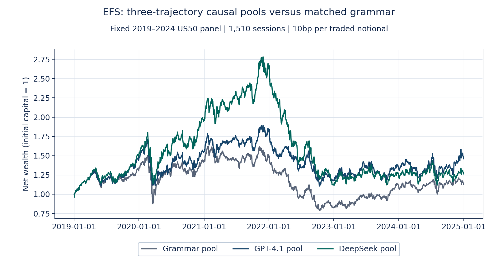
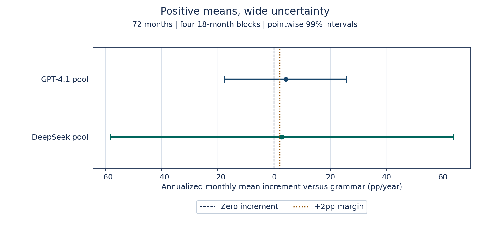
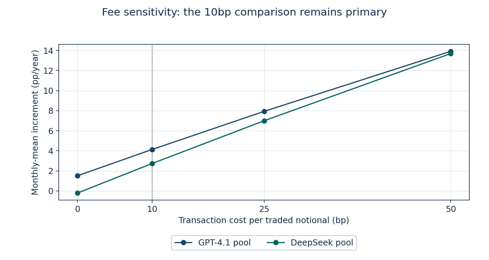
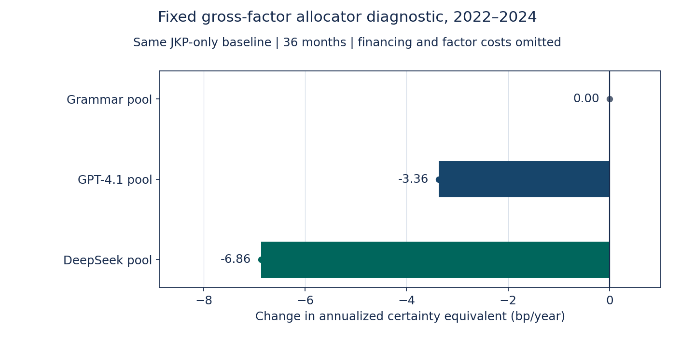

# EFS: completed matched-pool comparisons

The causal GPT-4.1 and DeepSeek pools add +4.128 and +2.729 percentage points of annualized monthly mean net return, respectively, over the fixed three-trajectory grammar pool at10bp. Both99% intervals include zero and the+2pp/year margin; neither establishes equivalence nor rules out a positive2pp effect. Their conservative four-case adjusted p-values are both1.0.

This is the frozen paper-guided US50 implementation; an attributable author implementation was not recovered. Current served models are disclosed substitutions, including DeepSeek-V3-0324/SiliconFlow. Exact replay and account conformance validate this implementation, not the original paper across its markets, models and ablations.

These complete EFS comparisons do not complete the original four-case family: strict Alpha remains unavailable. Quanta plus the two EFS effects comprise three available cases, retaining four in the correction denominator. The separately completed Alpha observed-history sensitivity cannot fill the missing original contrast. No significant incremental alpha or full-paper reproduction is established.

## Net account paths



| Pool | Ending wealth | 252-session geometric annualization | Maximum drawdown |
|---|---|---|---|
| Grammar pool | 1.127547 | 2.024% | -51.444% |
| GPT-4.1 pool | 1.459838 | 6.517% | -41.545% |
| DeepSeek pool | 1.263275 | 3.977% | -59.888% |

[All42 performance rows](visual_tables/performance_full_audit.csv). Displayed paths are the causal10bp pools on the same1,510-session US50 history. Growth is252-session geometric annualization, not calendar-time CAGR. Primary inference instead uses72 compounded monthly returns and12-times monthly mean differences.

## Primary effects and uncertainty



| Pool minus grammar | Mean, pp/year | Pointwise99% interval, pp | Raw p | Conservative4p |
|---|---|---|---|---|
| GPT-4.1 pool | +4.128 | [-17.462, 25.718] | 0.345465 | 1.000 |
| DeepSeek pool | +2.729 | [-58.209, 63.667] | 0.810609 | 1.000 |

[Full primary statistics](visual_tables/primary_full_audit.csv) · [Partial project-family audit](visual_tables/project_family_full_audit.csv). Four equally sized18-month blocks make grouped and full-sample mean differences equal here. The intervals are pointwise, not simultaneous2pp bounds; the correction is conservative4p, not Holm on a reduced three-case family. Quanta’s broader adjusted p remains0.555869.

## Matched scope and chronology

| Setting | Frozen choice and limit |
|---|---|
| Matched trajectories | Three per pool; grammar seeds101/102/103 fixed before pooled comparison |
| Search budgets | 290planned rounds and870planned candidates per trajectory; actual LLM admission/parsing failures retained |
| Libraries | Grammar1104; GPT-4.1 1820; DeepSeek2198 union functions, including initial seeds |
| Formation | Earliest discovery-date gating; frozen paper-guided financial engine |
| Primary cost | 10bp per traded notional;0/25/50bp descriptive |
| Hindsight | Retrospective final-union accounts retained only as diagnostics |
| Replication boundary | Hypothesis spaces, compute and model dollars differ; no isolated LLM-specific causal advantage |

All six LLM source trajectories passed290-round completion, exact full cached replay, holdings/output identities, every preserved transport prefix and frozen engine checks. Every pool’s eight saved account paths independently re-account within9.35e-16. The grammar pool recovers the frozen execution archive without a new search. Raw historical driver bytes differ from a later formatted copy; archive/AST/generator/account evidence are distinct, not a claim of byte identity. All ten historical grammar controls and six individual LLM trials remain in the full audit table; no favorable individual replaces a pool.

## Fee sensitivity



| Cost, bp | GPT increment, pp/year | DeepSeek increment, pp/year |
|---|---|---|
| 0 | +1.504 | -0.221 |
| 10 | +4.128 | +2.729 |
| 25 | +7.930 | +6.993 |
| 50 | +13.922 | +13.695 |

[Full fee audit](visual_tables/cost_sensitivity_full_audit.csv). Each model pool is compared with the grammar pool at the same cost. These eight descriptive comparisons do not change the primary fee or enter as selected replacements.

At zero costs, the mean increments are +1.504pp/year for GPT-4.1 and -0.221pp/year for DeepSeek. The relative gap grows along this fee ladder because costs reduce grammar returns more than model-pool returns in this sample. Each pool's absolute ending wealth decreases as costs rise. The frozen10bp comparison remains primary; no fee was selected from the better-looking result.

## What the JKP diagnostics can identify

Unrestricted JKP132-plus-market attribution would require134 coefficients including the intercept, with only72 monthly observations. It is not identified and was refused; no pseudoinverse estimate is presented as unrestricted alpha. The prespecified six-factor projection is a separate conditional diagnostic. Its factor list is fixed in [the protocol](../efs_final_analysis_protocol.json).

| Diagnostic | Role and limit |
|---|---|
| Six-factor grouped intercept | Conditional low-dimensional projection; not JKP132 residual alpha |
| Expanding ridge10 / PCA5-ridge10 | Prior36+months fit coefficients/scaling/PCA; contemporaneous factor realizations reconstruct the current difference |
| Fixed allocation | Prior-history weights; common JKP-only baseline and identical policy for both LLM pools and grammar |

| Pool | Grouped intercept, pp/year | Pointwise99% interval, pp | Diagnostic raw p |
|---|---|---|---|
| GPT-4.1 pool | +4.971 | [-26.481, 36.423] | 0.424014 |
| DeepSeek pool | -0.059 | [-59.354, 59.236] | 0.995728 |

[Full attribution audit](visual_tables/six_factor_and_unidentified_full_audit.csv). Block-specific fitted intercepts and the full-sample OLS intercept are different estimators; the table reports the grouped quantity. These tests are outside the primary family.

| Pool | Projection | Monthly RMSE, pp | Annualized residual mean, pp |
|---|---|---|---|
| GPT-4.1 pool | ridge_all_factors | 4.867 | -6.519 |
| GPT-4.1 pool | pca5_ridge | 4.285 | -5.660 |
| DeepSeek pool | ridge_all_factors | 5.057 | -20.919 |
| DeepSeek pool | pca5_ridge | 4.264 | -23.167 |

[Full reconstruction audit](visual_tables/reconstruction_full_audit.csv). These36-month2022–2024 reconstructions use contemporaneous factor realizations. They are not tradable forecasts, and their residual means are not unrestricted-alpha p-values.

## Fixed gross-factor allocation diagnostic



| Added sleeve | CE change, bp/year | Mean sleeve exposure in input units |
|---|---|---|
| Grammar pool | +0.000 | 0.00000000 |
| GPT-4.1 pool | -3.364 | 0.00120044 |
| DeepSeek pool | -6.864 | 0.00132702 |

[Full allocator audit](visual_tables/allocation_full_audit.csv) · [Increment audit](visual_tables/allocation_increment_full_audit.csv). The common JKP-only certainty equivalent is0.374148% annually under risk aversion10. The grammar sleeve receives zero weight; both LLM sleeves slightly lower this chosen diagnostic in this realization. This does not establish what every allocator could achieve. Exposures are weights in original input-return units, not stand-alone recommendations.

The fixed policy uses expanding36-month initialization, covariance diagonal shrinkage0.5, past-volatility scaling to0.10, nonnegative agent exposure, signed factor weights and L1 risk-budget cap1. Agent internal10bp costs are included; factor internal turnover, financing and allocation-change costs are absent. This is neither a net deployable fund nor a claim about the best attainable frontier.

## Calibration and claim boundaries

Monthly inference uses the existing N72 validation,2000 replications per cell, with all18 zero-effect cells retained. Mean-contrast nominal99% coverage ranged98.6–99.2%; six-factor coverage98.4–99.35%. Some coverage is below nominal. Approximate independent normal block estimates and Monte Carlo uncertainty remain; no exact real-world1% guarantee or transfer of nativeN238/963 calibration is claimed. See [monthly validation reference](../efs_monthly_inference_reference.json).

Libraries and trajectories share a historical market path. These conditional comparisons do not integrate all search uncertainty, create independent market histories, establish pristine model/data snapshots, or reproduce every original-paper experiment. Frozen v1’s six-case family remains separate and unchanged. All69 papers retain distinct evidence/gaps. Independent human source review and the final whole-study archive remain external or pending.

## Evidence and reproduction

[Report validation](validation.json) · [Lineage](lineage.json) · [Completed EFS analysis](../efs_pooled_analysis/completion.json) · [Source review packet](../SOURCE_REVIEW_PACKET.md).

The builder verifies completed public/private/source/pool hashes, re-accounts24 pool paths, recomputes42 performance rows,2primary contrasts,8fee differences,2six-factor projections and4reconstruction residual summaries, and checks6allocator summaries and the partial-family correction. It writes no source/model result, fits no new native search/model and makes no API call. The [no-image report](REPORT.md) contains the same tables and definitions.

From the canonical checkout, with no existing report directory:

```bash
/nfs/roberts/project/pi_btk22/zc362/environments/venvs/alpha-agent-replication-py312-20260813/bin/python scripts/build_efs_pooled_report_v2.py
```

Inspect and preserve any existing complete or partial report before regeneration.
