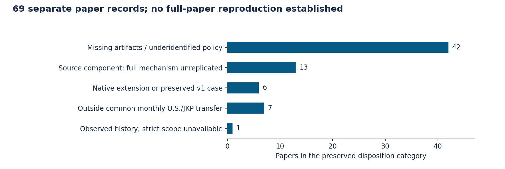
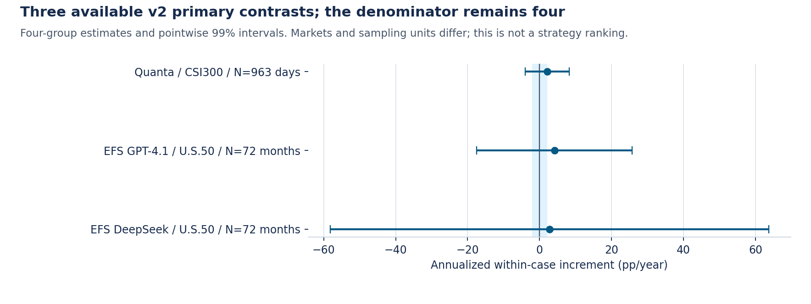
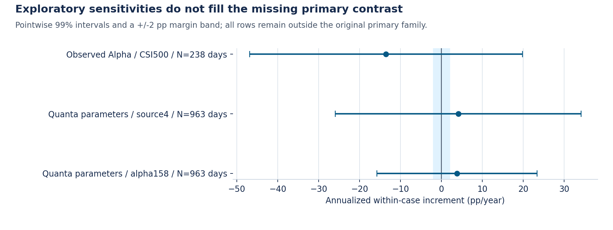

# Economic fidelity and bounded evidence for LLM investment strategies

**INTERIM MANUSCRIPT - final equity closure and independent review pending.**

## Economic fidelity and bounded evidence for LLM investment strategies

**INTERIM MANUSCRIPT - final 13-equity accounting, full publication packaging and independent human review remain open. No final publication or archive readiness is claimed.**

This manuscript integrates a preserved 69-paper evidence audit with completed native or explicitly adapted experiments. It separates four questions: whether source mechanisms can be executed, whether the observed histories and financial accounts can be reproduced, whether an incremental return is identified under matched conditions, and whether the original paper has been reproduced. The current evidence supports many computational and accounting checks, but establishes zero full-original-paper replications.

The available v2 primary family contains three of four prespecified contrasts: released-default Quanta and two EFS pools. Their pointwise 99% intervals remain wide and all adjusted positive-increment flags are false; strict Alpha remains unavailable. Separately, the all 20 observed-history Alpha sensitivity has a full-sample opening increment of -13.557 pp/year, while the Quanta parameter sensitivity over Alpha158 is +3.776 pp/year. Both remain inconclusive at the 2 pp annual margin and neither replaces a missing primary.

The expanded equity source work has 3,480 newly validated replay records. Final accounting for the full 13-cohort main equity set is not available because AMZN stopped at a separately approval-gated HTTP 500 request. The final aggregate is therefore withheld. One sealed prospective observation was settled without a new model call; a single outcome provides no significance evidence.

| Evidence layer | Current status |
| --- | --- |
| 69-paper register | Separate titles, dispositions and gap references retained |
| Completed factor case studies | EFS, released Quanta, observed Alpha and Quanta parameters preserved |
| Expanded equity accounts | Final 13 aggregation missing; no partial substitution |
| Independent human review | External and not asserted |
| Publication packages | Final immutable bundles and durable second copies not complete |

All figures and tables in this draft are presentations of existing completed artifacts. No source, factor, model, account, replay or financial analysis job was rerun to assemble the manuscript.

## 1. Evidence coverage is not a reproduction count

Figure 1. Preserved review dispositions, not counts of successful strategies.

| Code | Disposition | Papers |
| --- | --- | --- |
| A | Missing artifacts / underidentified policy | 42 |
| B | Source component; full mechanism unreplicated | 13 |
| C | Native extension or preserved v1 case | 6 |
| D | Outside common monthly U.S./JKP transfer | 7 |
| E | Observed history; strict scope unavailable | 1 |

[Full audit CSV](audit_tables/paper_disposition_counts.csv)

All 69 identifiers and full titles appear in Appendix A and the full audit CSV. Each retains a separate gap description and a verified metadata link. A source-component result or common-transfer surrogate is not relabelled as a complete native mechanism. A missing artifact is not evidence that recovery is impossible forever; it is a bounded statement about the preserved audit.

Seven papers are outside the common monthly U.S./JKP transfer scope because their native task does not map without replacing its mechanism. This does not establish failure in their intended market or task. The six native-extension/preserved-v1 records and the separate observed-history record likewise do not establish full-paper reproduction.

The paper register itself is unchanged by this manuscript. No new author contact, upstream availability search or human attestation is represented by the drafting pass.

## 2. Design, data boundaries and execution clocks

The design preserves all declared source attempts, failed histories, exact responses and source-used programs. It restores recoverable mechanisms and settings before evaluating an economic contrast. Historical model snapshots, alternative-data vintages and some paper run designs remain unavailable, so current-model or adapted executions are identified as such. No best-return trajectory is promoted into a primary family.

| Component | Formation/source boundary | Evaluation / interpretation |
| --- | --- | --- |
| Alpha observed history | Five OHLCV fields physically bounded through 2025-01-02; first 100 source-ordered debug subset through 2024-12-30 | First signal Jan 3/fill Jan 6,2025;238 later sessions, CSI500 |
| Quanta searches | Six fields through 2022-01-05; original 100-stock 2018-19 debug; paper source train 2016-19/valid 2020/feedback 2021 | First signal Jan 6/fill Jan 7,2022;963 later sessions, CSI300 |
| EFS pools | Frozen paper-guided U.S.50 implementation; author implementation not recovered | 1,510 daily observations compounded into 72 months |
| Equity agents | Preserved dated inputs and exact native histories; one trajectory per asset | Final 13-cohort aggregate withheld pending AMZN closure |

Evaluation HDFs were not supplied to generation. Full-universe program proofs remove actual future rows at fixed historical cutoffs; a debug-only truncation is insufficient. These tests check dependence of the saved programs on future rows, not historical model contamination or every possible form of leakage.

Native Qlib opening eligibility uses same-day closing-change and missingness information. The declared opening-information proxy instead requires finite positive current open and prior close with the same 9.5% threshold, while preserving saved predictions, labels, fees, lots and dates. The 2019 audit found 433 buy and 181 sell discrepancies on 72,964 stock-days. Board-specific limits, auction/liquidity mechanics and adjustment-vintage fidelity remain gaps.

The word symbol in Quanta symbol-length limits concerns expression complexity, not the stock-universe size. Every return comparison retains its own market, sample and recorded economic settings; pooled rankings across these cases would not be identified by this design.

## 3. Available v2 primary evidence

Figure 2. Available contrasts in their own markets and sampling units. The missing strict Alpha row is not replaced.

| Within-case contrast | Full mean pp/y | 99% group interval | Raw p | 4p upper |
| --- | --- | --- | --- | --- |
| Released Quanta / CSI300 / 963 sessions | +2.096 | [-4.021, +8.217] | 0.1390 | 0.5559 |
| EFS GPT-4.1 / U.S.50 / 72 months | +4.128 | [-17.462, +25.718] | 0.3455 | 1.0000 |
| EFS DeepSeek / U.S.50 / 72 months | +2.729 | [-58.209, +63.667] | 0.8106 | 1.0000 |

[Full audit CSV](audit_tables/v2_primary_available.csv)

**THREE OF FOUR PRIMARY CONTRASTS AVAILABLE. The strict Alpha comparison is absent; the multiplicity denominator stays four. Do not apply Holm to only the three available cases.**

For released Quanta, the opening Alpha158 full-sample mean increment is+2.095706 pp/year, with grouped 99% interval[-4.021037,+8.217106] pp. Its local two-case conservative p bound is 0.277934, but the project four-case bound is 0.555869. The EFS four-case bounds are 1.0. All positive family flags remain false and all three available comparisons are inconclusive at the 2 pp margin.

EFS increments use 12 times the mean difference of compounded monthly returns. Quanta uses 252 times the mean daily net-return difference. The plotted points are equal-weight group means; the table uses the full-sample mean and labels the group interval separately. The rows are not interchangeable estimates of a common strategy population.

## 4. EFS: matched pools and limits on attribution

All EFS sources, replays, matched grammar and both LLM pools, paired analysis and the partial primary-family collector are complete. Three trajectories are retained in each pool; the matched grammar uses fixed seeds 101/102/103. The comparison is a frozen paper-guided U.S.50 implementation. Attributable author implementation was not recovered, so neither author-code equivalence nor full-paper reproduction is claimed.

| Pool | Trajectories | Recorded functions | Primary contrast |
| --- | --- | --- | --- |
| Matched grammar | 3 | 1104 | Common reference |
| GPT-4.1 | 3 | 1820 | +4.128067 pp/y; 99% [-17.461784,+25.717918] |
| DeepSeek-V3 | 3 | 2198 | +2.728569 pp/y; 99% [-58.209449,+63.666587] |

Twenty-four cost/mode paths cover 1,510 days and 72 months. Independent re-accounting has maximum difference 9.35e-16. The 10 bp path remains primary. At zero cost, the descriptive increments are approximately+1.504 pp/year for GPT and-0.221 pp for DeepSeek. Relative gaps increase as fees rise while each pool's absolute wealth falls; that pattern is not evidence that fees create alpha.

Unrestricted 134-parameter JKP regression is refused on 72 monthly observations. The six-factor and expanding 36-month ridge 10/PCA 5 contemporaneous reconstructions are diagnostics, not forecasts or unrestricted-alpha tests. A common JKP-only allocator baseline is verified; the 36 x 2 x 134 weight diagnostics have certainty-equivalent changes of-3.364 bp/year for GPT and-6.864 bp for DeepSeek, with zero change for grammar.

Missing factor turnover, financing and allocation costs preclude net-fund or efficient-frontier claims. The monthly N=72 calibration has some subnominal cells across 2,000 replications and 18 settings. Daily N=238 or 963 calibration cannot be borrowed to certify monthly coverage.

Evidence: efs_economic_completion.json and efs_pooled_analysis/completion.json. Their completed rows are preserved, including historical local status labels; the current collector, not a rewrite of those rows, records the available 3/4 project family.

## 5. Quanta: released search and parameter sensitivity

Released-default Quanta preserves source/full replay, seven source tasks, sixteen consumed-program proofs, pooled native/opening accounts and all seven task libraries. Under opening eligibility, 6/7 task Alpha158 increments are negative; their median is -0.661209 pp/year. All 14 opening secondary comparisons have conservative 54-family p bounds of 1.0. No selected task replaces the pooled comparison.

The separate parameter sensitivity changes the active symbol-length threshold 300 to 250, duplication 8 to 5, enables consistency checks and requests three factors, with ten directions/ten crossovers and five total phases under Appendix A.4; Appendix B conflicts. The old factor YAML was inactive. Current GPT-5.2/OpenAI, max 3000, reasoning none and recorded ordinal seeds are not historical-model equivalence. Several settings and histories differ jointly, so this is not an isolated parameter effect.

| Execution / baseline | Full mean pp/y | 99% group interval | Raw p |
| --- | --- | --- | --- |
| Native / Source4 | +4.244 | [-26.483, +34.988] | 0.4781 |
| Native / Alpha158 | +3.865 | [-8.234, +15.975] | 0.1586 |
| Opening / Source4 | +4.083 | [-25.938, +34.119] | 0.4844 |
| Opening / Alpha158 | +3.776 | [-15.763, +23.335] | 0.3402 |

[Full audit CSV](audit_tables/all_quanta_parameter_comparisons.csv)

All 142 source-used hashes become 142 expression columns in an 801,001-row fixed library. Four native/opening accounts pass 963 sessions each. Two augmented fits and two saved-prediction opening replays reuse four common baseline paths without refitting. The opening Alpha158 increment is+3.776 pp/year; all four comparisons remain inconclusive at 2 pp. Opening terminal wealth is 1.28390444 versus 1.11534581 for Alpha158, and 1.16705330 versus 1.01359912 for Source4.

Both the complete original and interrupted partial histories, separate LOOP/POOL identities, current inputs and all saved source-period backtests are preserved. The source contains 3,644 chat, 589 embedding and 680 quality records; these are workflow counts, not independent successes. Source reconstruction uses seeded control flow, not a comparison with unavailable original RAM. All source, proof and economic jobs are complete and are not rerun by this draft.

## 6. Observed Alpha history: useful evidence with a strict-scope failure

Figure 3. Supplemental opening comparisons. None is a substitute for the unavailable strict Alpha primary.

| Exploratory comparison | N days | Full mean pp/y | 99% group interval | Raw p |
| --- | --- | --- | --- | --- |
| Observed Alpha / opening / Alpha158 | 238 | -13.557 | [-46.893, +19.782] | 0.0981 |
| Quanta parameters / opening / Source4 | 963 | +4.083 | [-25.938, +34.119] | 0.4844 |
| Quanta parameters / opening / Alpha158 | 963 | +3.776 | [-15.763, +23.335] | 0.3402 |

[Full audit CSV](audit_tables/exploratory_opening_comparisons.csv)

The all 20 observed-history sensitivity retains 20 outcomes, 96 actual attempts, 4 unattempted rounds and 86 histories. Trials 12/14 ended after three attempts; trials 08/15 failed on their final fifth attempt. No missing round, replacement response, successful-trial subset or retry is imputed. Final-round recognition requires five actual attempts; an early abort does not qualify.

The strict 20-by 5 source gate therefore remains unmet, its pooled primary stays held, and its original downstream four-primary/54-secondary families remain unavailable. The separate observed library has 159 uses, 157 program hashes and 146 expression columns; eleven exact-expression duplicates are numerically identical. The exploratory opening full-sample increment is-13.557404 pp/year, with 99% group interval[-46.893161,+19.782131] pp and raw p 0.098061. This is inconclusive, not a significant-loss or LLM-specific claim.

## 7. Raw values and processed model inputs

Preserving the executed inputs includes preserving nonfinite raw values and missingness. Finite processed inputs do not justify deleting raw infinity flags, changing a program or describing the source as uniformly finite. The following populations refer to distinct matrices and cannot be added.

| Library | Raw matrix | Raw infinity | Raw missing | Distinct scope |
| --- | --- | --- | --- | --- |
| Observed Alpha | 1,335,155 x 146 | 5 cells /2 programs | 5,464,865 | Observed-history fixed library |
| Quanta parameters | 801,001 x 142 | 32,359 cells /7 columns | 1,977,960 | CSI300 membership-filtered fixed matrix |

Quanta has 12 whole-universe proof program flags but only 7 infinite columns in the membership-filtered library. These are different universes and overlapping check scopes, not a contradiction and not a summed count of unique cells. All 142 programs remain present. Full-panel/four-cutoff checks compare actual future-row truncations and the exact native feature matrices.

| Processed inputs | Features | Infinity | Other retained diagnostics |
| --- | --- | --- | --- |
| Observed Alpha baseline / augmented | 158 /304 | 0 | Two constant-or-missing columns per segment; train/valid/test missing cells 2,206,039/372,206/394,459 |
| Quanta Source4 / Alpha158 augmented | 146 /300 | 0 | No missing or constant/missing columns in train/valid/test; rows 282,088/72,754/289,011 |

The Quanta proof checker originally rejected preserved original model matrices for being outside the continuation folder, despite all 50 hashes matching. The corrected version permits only exact source-admitted original/new workspace/path/hash/column bindings before factor execution. It preserves all numerical and real future-row-removal checks. Failed attempts and the previous checker remain archived; completed proofs were reused rather than repeated.

No library/program/record counts are added to the equity replay headline. An exact replay or a causal-prefix diagnostic establishes a narrow computational property, not economic value, pristine historical model inputs or full-paper fidelity.

## 8. Expanded equities: source closure and the missing final accounts

The new full-replay record headline is 3,480:1,648 from four FinMem additions, 183 from three original TradingAgents assets, 61 from the separate Alphabet-news repair, and 1,588 from four admitted FinAgent continuations. These are workflow records, not independent observations or repeated paper trials. The original FinMem TSLA cohort belongs to the main accounting set but is not newly counted here.

| Source cohort | New exact records | Current boundary |
| --- | --- | --- |
| FinMem additions | 1648 | Four 412-record replays; 259 training and 1 test Guard failures retained |
| TradingAgents original assets | 183 | AAPL/AMZN/GOOGL, 61 each; one trajectory per asset |
| Separate TA news repair | 61 | Outside the final 13 main-cohort aggregate |
| FinAgent AAPL/GOOGL/MSFT/TSLA | 1588 | Four 397-record source/full replay/current V3 admissions |
| FinAgent AMZN | No full-source credit | 220 training records preserved; HTTP 500 exception approval unanswered |

[Full audit CSV](audit_tables/equity_replay_records.csv)

**FINAL 13-EQUITY ACCOUNTS ARE MISSING. The main set is FinMem 5 + TradingAgents 3 + FinAgent 5. AMZN source/full replay remains unfinished; no old preview or partial result is substituted into the final aggregate.**

FinAgent continuations preserve all original and overlapping prefixes. GOOGL retains the exact inner response text under the single four-tag markup alias, and TSLA retains the literal long_term_reasonig alias. The seven returned embedding responses were reconciled with their full original reservations charged; provider usage is reported separately, not as a billing-equality claim.

For TradingAgents Alphabet news, the corpus expanded from 88 to 10,117 items while 373 prices were unchanged. All 61 news reports changed, but the original and repaired policies both chose BUY on all 61 steps and all eight clock/fee paths are identical. This is no added realized return in this trajectory, not a general claim that news never helps. The failed duplicated-feed variant stays separate.

## 9. Inference, multiplicity and what remains unidentified

The economic margin is 2 percentage points/year. Four contiguous-group estimates provide t-based pointwise 99% intervals under stated approximate group-independence and normality assumptions. Full-sample and equal-weight group means differ when block lengths differ. A point estimate above the margin is not evidence that the margin is exceeded; a nonsignificant p-value is not evidence of zero alpha or equivalence.

| Family | Membership rule | Current treatment |
| --- | --- | --- |
| Frozen v1 six | Six recorded historical primary contrasts | Complete original family; all six inconclusive |
| Native local two | Released Quanta and strict Alpha | Quanta available; conservative 2 p where partial |
| Current v2 four | Strict Alpha, released Quanta, two EFS contrasts | Three available; denominator 4, conservative 4p; no Holm 3 |
| Secondary 54 | Seven Quanta tasks plus strict Alpha trial panel | Quanta case complete; missing Alpha does not reduce denominator |
| Observed Alpha / Quanta parameters | Separately declared exploratory sensitivities | Raw descriptive p-values; no primary-family substitution |

The intervals are not simultaneous bounds on the economic margin. Degenerate sampling variation receives p=1 in the guarded inference path. Tasks and assets share market histories; source records, generated factors and model fits do not create independent financial replications. Model-seed and historical-model/data uncertainty are not estimated by a conditional return-path interval.

The original short-sample bootstrap undercoverage remains a diagnostic, not a reason to select a better-looking inference method after viewing the returns. Calibration is tied to its sample length and simulated processes. Monthly 72-observation EFS coverage cannot be certified by native 238/963-session calibration.

The original sealed prospective forecast was settled without a new model call or altered commitment. Its single outcome is retained in the evidence chain. One observation cannot establish significance or prospective investment value; the historical analysis is not converted into an untouched holdout claim.

## 10. Frozen v1 results remain a separate historical layer

The completed six-case study is retained as originally recorded. Its controls, sample windows and adapters are not relabelled as the newer experiments, and the new sensitivities do not replace its rows. Direct between-version performance differences are not isolated causal effects because mechanisms, inputs or comparison scope can differ.

| Case | N / annualizer | Full mean pp/y | Pointwise 99% interval | Holm 6 p |
| --- | --- | --- | --- | --- |
| EFS | 72 / 12 | +13.176 | [-19.504, +45.855] | 0.5992 |
| GuruAgents | 36 / 12 | -2.291 | [-10.148, +5.565] | 0.9351 |
| QuantaAlpha | 48 / 12 | -1.484 | [-21.735, +18.768] | 1.0000 |
| FinMem | 127 / 252 | -2.113 | [-111.224, +107.031] | 1.0000 |
| TradingAgents | 61 / 252 | -6.226 | [-293.632, +280.972] | 1.0000 |
| FinAgent | 147 / 252 | -15.025 | [-162.185, +132.960] | 1.0000 |

[Full audit CSV](audit_tables/frozen_v1_six_primaries.csv)

All six recorded verdicts are inconclusive at the 2 pp margin. The monthly EFS/GuruAgents/Quanta rows and daily equity rows retain their own annualization and sample lengths. Their very different interval widths must not be hidden by calling all rows an interchangeable benchmark.

The frozen v1 analysis status still contains its then-current prospective label. This draft cites the subsequently settled outcome record separately rather than rewriting that historical status. Its source commitments, EFS semantic seals and earlier report/manuscript remain untouched.

Likewise, three method references in the completed released-Quanta secondary analysis point to earlier helper versions. Exact copies matching all three recorded hashes were recovered from the September 17 methods snapshot. This draft binds those executed versions; current helper files and completed economic results were not changed and the analysis was not rerun.

## 11. Cost exposure, integrity and release conditions

The locked project commitment at 2026-09-20T23:02:42.727642+00:00 is $357.65660256, including historical spending and uncertain reservations. The soft stop is $450 and hard ceiling $500. The following are shared study commitments, not necessarily incremental costs of the displayed sensitivity.

| Shared study | Committed USD | Cap USD |
| --- | --- | --- |
| Alpha shared routes | 12.77332194 | 20 |
| EFS | 11.42382400 | 35 |
| FinAgent | 131.69786213 | 160 |
| FinMem | 38.90290200 | 55 |
| Input summaries | 2.15738900 | 5 |
| Quanta shared variants | 50.90319364 | 75 |
| TA news repair | 2.41539695 | 5 |
| TradingAgents original | 6.57514820 | 20 |

[Full audit CSV](audit_tables/committed_budget.csv)

The four witnessed Alpha missing-response reservations total $0.116085 and remain charged. The original Quanta returned-response reservation remains exactly RESERVED at $0.0556885; its journal body is preserved and its full charge retained. AMZN retains $0.00012324 with no returned body in the recorded failure evidence. These amounts are already included in commitments; they are not added again, refunded or classified as failures merely by age.

The read-only request preflight recognizes the completed Quanta economic artifact but remains blocked by missing final 13-equity accounts. It has not performed the final fresh dual-store scan or qualified the returned Quanta reservation for the eventual snapshot. A final packager must repeat current source/account/request checks inside its own consistent snapshot transaction and separately verify public/private content, privacy and durable second copies.

**This draft is not a publication certificate. Final 13 V3 equity accounting, final manuscript integration, immutable public/private bundles and independent durable-copy verification remain open. Independent human source review is external. AMZN retry approval remains unanswered; the heartbeat or this manuscript does not authorize it.**

## 12. Conclusions and reproducibility contract

The strongest supported conclusion is conditional and bounded: the completed studies provide auditable source histories, replay checks, native accounting and explicitly labelled economic comparisons. They do not establish a universal absence of alpha, full reconstruction of every paper, an isolated LLM-specific advantage or a pristine historical experiment.

The current primary-family evidence remains incomplete and inconclusive. The separate observed-history and parameter sensitivities are complete within their declared scopes, with failures, unattempted rounds, raw nonfinite values and input adaptations retained. Their completion is a computational achievement, not permission to replace a missing strict primary.

This manuscript is assembled without rerunning completed studies. Its 145 input files and 69 paper metadata links are hash-verified; historical method versions are resolved to exact archived bytes when a completed receipt points to an older helper. The source register, all canonical results and the old v1 manuscript are unchanged. Full audit tables retain exact figures, identifiers, source links, scope fields and unabridged gap metadata.

| Artifact | Role |
| --- | --- |
| input_manifest.json | Source paths/hashes; private immutable input-copy reference |
| audit_tables/all_69_papers_full_audit.csv | Every title, disposition, original status and full gap metadata |
| audit_tables/v2_primary_available.csv | Three available rows; denominator remains four |
| audit_tables/exploratory_opening_comparisons.csv | Observed Alpha and Quanta parameter opening sensitivities |
| audit_tables/historical_method_versions.csv | Recorded source hash versus exact archived executed copy |
| manuscript_draft_v1.pdf / MANUSCRIPT.md | Interim PDF and text generated from the same content model |

Reproduce this presentation from the verified input bundle using scripts/build_fidelity_manuscript_draft_v1.py and scripts/validate_fidelity_manuscript_draft_v1.py under the immutable central kt-python runtime. These builders do not submit Slurm jobs, call a model, re-account a portfolio or run a source/proof. Completed draft artifacts are preserved; a later manuscript revision receives a new version.

Human review and final release checks are not simulated by machine or assistant QA. Before a stronger claim is written, its missing inputs, scope restrictions and actual economic evidence must be resolved explicitly rather than hidden by a more fluent summary.

## Selected archived references

[EFS] EFS: Evolutionary Factor Searching for Sparse Portfolio Optimization Using Large Language Models, v1. https: //arxiv.org/abs/2507.17211v1

[FinMem] FinMem: A Performance-Enhanced LLM Trading Agent with Layered Memory and Character Design. https: //arxiv.org/abs/2311.13743

[FinAgent] A Multimodal Foundation Agent for Financial Trading: Tool-Augmented, Diversified, and Generalist. https: //arxiv.org/abs/2402.18485

[TradingAgents] TradingAgents: Multi-Agents LLM Financial Trading Framework, v7. https: //arxiv.org/abs/2412.20138v7

[GuruAgents] GuruAgents: Emulating Wise Investors with Prompt-Guided LLM Agents. https: //arxiv.org/abs/2510.01664

[QuantaAlpha] QuantaAlpha, v3. https: //arxiv.org/abs/2602.07085v3

[FINSABER] FINSABER benchmark and released alternative data. https: //arxiv.org/html/2505.07078v6

[Stationary bootstrap] Politis and Romano (1994), The Stationary Bootstrap. https: //doi.org/10.1080/01621459.1994.10476870

[HAC] Newey and West (1987), A Simple, Positive Semi-Definite, Heteroskedasticity and Autocorrelation Consistent Covariance Matrix. https: //www.jstor.org/stable/1913610

[Grouped t] Ibragimov and Muller (2010), t-Statistic Based Correlation and Heterogeneity Robust Inference. https: //www.princeton.edu/~umueller/tstat.pdf

[Equivalence] Schuirmann (1987), A comparison of the two one-sided tests procedure and the power approach for assessing equivalence. https: //pubmed.ncbi.nlm.nih.gov/3450848/

References identify source papers and inference methods used by the preserved study. Versioned source audits and the complete 69-paper index carry the implementation and availability evidence. A citation does not establish that an original historical model, dataset or full author pipeline was reproduced.

## Appendix A. Complete paper index (1-12 of 69)

Disposition codes: A=missing artifacts/underidentified policy; B=source component, full mechanism unreplicated; C=native extension/preserved v1 case; D=outside common monthly U.S./JKP transfer; E=observed history with strict scope unavailable. Every row retains its own complete gap record in the audit CSV.

| Paper ID | Full title | Code |
| --- | --- | --- |
| M001 | GPT-Signal: Generative AI for Semi-automated Feature Engineering in the Alpha Research Process | B |
| M002 | CryptoTrade: A Reflective LLM-based Agent to Guide Zero-shot Cryptocurrency Trading | D |
| M003 | Can Large Language Models Mine Interpretable Financial Factors More Effectively? A Neural-Symbolic Factor Mining Agent Model | A |
| M004 | FLAG-TRADER: Fusion LLM-Agent with Gradient-based Reinforcement Learning for Financial Trading | A |
| M005 | AlphaQuanter: An End-to-End Tool-Augmented Agentic Reinforcement Learning Framework for Stock Trading | A |
| M006 | FinMem: A Performance-Enhanced LLM Trading Agent with Layered Memory and Character Design | C |
| M007 | QuantAgent: Seeking Holy Grail in Trading by Self-Improving Large Language Model | B |
| M008 | Alpha-GPT 2.0: Human-in-the-Loop AI for Quantitative Investment | A |
| M009 | A Multimodal Foundation Agent for Financial Trading: Tool-Augmented, Diversified, and Generalist | C |
| M010 | LLMFactor: Extracting Profitable Factors through Prompts for Explainable Stock Movement Prediction | A |
| M011 | FinCon: A Synthesized LLM Multi-Agent System with Conceptual Verbal Reinforcement for Enhanced Financial Decision Making | A |
| M012 | Empirical Asset Pricing with Large Language Model Agents | A |

[Full audit CSV](audit_tables/all_69_papers_full_audit.csv)

No row is labelled full-original-paper reproduced. This index preserves the original 69 dispositions; it does not turn missing artifacts or scope incompatibility into negative evidence about the paper's native task.

## Appendix A. Complete paper index (13-24 of 69)

Disposition codes: A=missing artifacts/underidentified policy; B=source component, full mechanism unreplicated; C=native extension/preserved v1 case; D=outside common monthly U.S./JKP transfer; E=observed history with strict scope unavailable. Every row retains its own complete gap record in the audit CSV.

| Paper ID | Full title | Code |
| --- | --- | --- |
| M013 | FinVision: A Multi-Agent Framework for Stock Market Prediction | A |
| M014 | TradingAgents: Multi-Agents LLM Financial Trading Framework | C |
| M015 | LLM-Powered Multi-Agent System for Automated Crypto Portfolio Management | D |
| M016 | MarketSenseAI 2.0: Enhancing Stock Analysis through LLM Agents | A |
| M017 | FinRL-DeepSeek: LLM-Infused Risk-Sensitive Reinforcement Learning for Trading Agents | D |
| M018 | HedgeAgents: A Balanced-aware Multi-agent Financial Trading System | A |
| M019 | AlphaAgent: LLM-Driven Alpha Mining with Regularized Exploration to Counteract Alpha Decay | E |
| M020 | MASS: Muli-agent simulation scaling for portfolio construction | A |
| M021 | Navigating the Alpha Jungle: An LLM-Powered MCTS Framework for Formulaic Factor Mining | B |
| M022 | R&D-Agent: An LLM-Agent Framework Towards Autonomous Data Science | A |
| M023 | EFS: Evolutionary Factor Searching for Sparse Portfolio Optimization Using Large Language Models | C |
| M024 | MountainLion: A Multi-Modal LLM-Based Agent System for Interpretable and Adaptive Financial Trading | A |

[Full audit CSV](audit_tables/all_69_papers_full_audit.csv)

No row is labelled full-original-paper reproduced. This index preserves the original 69 dispositions; it does not turn missing artifacts or scope incompatibility into negative evidence about the paper's native task.

## Appendix A. Complete paper index (25-36 of 69)

Disposition codes: A=missing artifacts/underidentified policy; B=source component, full mechanism unreplicated; C=native extension/preserved v1 case; D=outside common monthly U.S./JKP transfer; E=observed history with strict scope unavailable. Every row retains its own complete gap record in the audit CSV.

| Paper ID | Full title | Code |
| --- | --- | --- |
| M025 | ContestTrade: A Multi-Agent Trading System Based on Internal Contest Mechanism | A |
| M026 | Chain-of-Alpha: Unleashing the Power of Large Language Models for Alpha Mining in Quantitative Trading | B |
| M027 | AlphaAgents: Large Language Model based Multi-Agents for Equity Portfolio Constructions | A |
| M028 | From Flat to Hierarchical: Evolving Tree-structured Thoughts for Fine-grained Alpha Mining | A |
| M029 | TradingGroup: A Multi-Agent Trading System with Self-Reflection and Data-Synthesis | A |
| M030 | MM-ARC: Multimodal Adaptive Routing of Capital with Robustness-Audited Strategy Pools | A |
| M031 | QuantHarness: Price-Driven Multi-Agent LLMs for High-Frequency Trading | D |
| M032 | Trading-R1: Financial Trading with LLM Reasoning via Reinforcement Learning | A |
| M033 | GuruAgents: Emulating Wise Investors with Prompt-Guided LLM Agents | C |
| M034 | QuantAgents: Towards Multi-agent Financial System via Simulated Trading | A |
| M035 | Trade in Minutes! Rationality-Driven Agentic System for Quantitative Financial Trading | D |
| M036 | Profit Mirage: Revisiting Information Leakage in LLM-based Financial Agents | A |

[Full audit CSV](audit_tables/all_69_papers_full_audit.csv)

No row is labelled full-original-paper reproduced. This index preserves the original 69 dispositions; it does not turn missing artifacts or scope incompatibility into negative evidence about the paper's native task.

## Appendix A. Complete paper index (37-48 of 69)

Disposition codes: A=missing artifacts/underidentified policy; B=source component, full mechanism unreplicated; C=native extension/preserved v1 case; D=outside common monthly U.S./JKP transfer; E=observed history with strict scope unavailable. Every row retains its own complete gap record in the audit CSV.

| Paper ID | Full title | Code |
| --- | --- | --- |
| M037 | ATLAS: Adaptive Trading with LLM AgentS Through Dynamic Prompt Optimization and Multi-Agent Coordination | A |
| M038 | P1GPT: a multi-agent LLM workflow module for multi-modal financial information analysis | A |
| M039 | FinPos: A Position-Aware Trading Agent System for Real Financial Markets | A |
| M040 | FINRS: A Risk-Sensitive Trading Framework for Real Financial Markets | A |
| M041 | Cognitive Alpha Mining via LLM-Driven Code-Based Evolution | B |
| M042 | Alpha-R1: Alpha Screening with LLM Reasoning via Reinforcement Learning | A |
| M043 | QuantaAlpha: An Evolutionary Framework for LLM-Driven Alpha Mining | C |
| M044 | FactorMiner: A Self-Evolving Agent with Skills and Experience Memory for Financial Alpha Discovery | B |
| M045 | Janus-Q: End-to-End Event-Driven Trading via Hierarchical-Gated Reward Modeling | D |
| M046 | FactorEngine: A Program-level Knowledge-Infused Factor Mining Framework for Quantitative Investment | B |
| M047 | Can Blindfolded LLMs Still Trade? An Anonymization-First Framework for Portfolio Optimization | A |
| M048 | AlphaLogics: A Market Logic-Driven Multi-Agent System for Scalable and Interpretable Alpha Factor Generation | A |

[Full audit CSV](audit_tables/all_69_papers_full_audit.csv)

No row is labelled full-original-paper reproduced. This index preserves the original 69 dispositions; it does not turn missing artifacts or scope incompatibility into negative evidence about the paper's native task.

## Appendix A. Complete paper index (49-60 of 69)

Disposition codes: A=missing artifacts/underidentified policy; B=source component, full mechanism unreplicated; C=native extension/preserved v1 case; D=outside common monthly U.S./JKP transfer; E=observed history with strict scope unavailable. Every row retains its own complete gap record in the audit CSV.

| Paper ID | Full title | Code |
| --- | --- | --- |
| M049 | TrustTrade: Human-Inspired Selective Consensus Reduces Decision Uncertainty in LLM Trading Agents | A |
| M050 | Designing Agentic AI-Based Screening for Portfolio Investment | A |
| M051 | Hubble: An LLM-Driven Agentic Framework for Safe, Diverse, and Reproducible Alpha Factor Discovery | A |
| M052 | Signal or Noise in Multi-Agent LLM-based Stock Recommendations? | A |
| M053 | AlphaCrafter: Harnessing Multi-Agent Workflows for Cross-Sectional Quantitative Trading | A |
| M054 | Strat-LLM: Stratified Strategy Alignment for LLM-based Stock Trading with Real-time Multi-Source Signals | A |
| M055 | SHARP: A Self-Evolving Human-Auditable Rubric Policy for Financial Trading Agents | A |
| M056 | From Feedback Loops to Policy Updates: Reinforcement Fine-Tuning for LLM-Based Alpha Factor Discovery | B |
| M057 | MadEvolve: Evolutionary Optimization of Trading Systems with Large Language Models | A |
| M058 | Macro Economists in the Machine: A Multi-Agent LLM Framework for Commodity-Related ETF Portfolio Construction | D |
| M059 | AlphaMemo: Structured Search-Process Memory for Self-Evolving Alpha Mining Agents | B |
| M060 | MetaPS: Adaptive Programmatic Strategy Selection for Market Agents | A |

[Full audit CSV](audit_tables/all_69_papers_full_audit.csv)

No row is labelled full-original-paper reproduced. This index preserves the original 69 dispositions; it does not turn missing artifacts or scope incompatibility into negative evidence about the paper's native task.

## Appendix A. Complete paper index (61-69 of 69)

Disposition codes: A=missing artifacts/underidentified policy; B=source component, full mechanism unreplicated; C=native extension/preserved v1 case; D=outside common monthly U.S./JKP transfer; E=observed history with strict scope unavailable. Every row retains its own complete gap record in the audit CSV.

| Paper ID | Full title | Code |
| --- | --- | --- |
| M061 | AI Trading's Alpha Singularity: Emergent Market Reasoning through Agent-to-Agent Self-Evolution | A |
| M062 | XALPHA: A Memory-Driven AI Quant Researcher for Hypothesis-to-Code Alpha Discovery | B |
| M063 | Fin-Analyst at FinMMEval 2026 Task 3: A Live Hybrid Trading Agent with LLM Specialists and Rule-Based Signals | A |
| M064 | AlphaSchema: Exploring the Space of Trading Semantics for LLM-Based Alpha Mining | B |
| M065 | FactorMAD: A Multi-Agent Debate Framework Based on Large Language Models for Interpretable Stock Alpha Factor Mining | A |
| M066 | AlphaAgentEvo: Evolution-Oriented Alpha Mining via Self-Evolving Agentic Reinforcement Learning | A |
| M067 | RAPTOR: Reasoned Agentic Portfolio Trading with Orchestrated Rebalancing | A |
| M068 | Alpha-GPT: Human-AI Interactive Alpha Mining for Quantitative Investment | B |
| M069 | Automate Strategy Finding with LLM in Quant Investment | B |

[Full audit CSV](audit_tables/all_69_papers_full_audit.csv)

No row is labelled full-original-paper reproduced. This index preserves the original 69 dispositions; it does not turn missing artifacts or scope incompatibility into negative evidence about the paper's native task.
