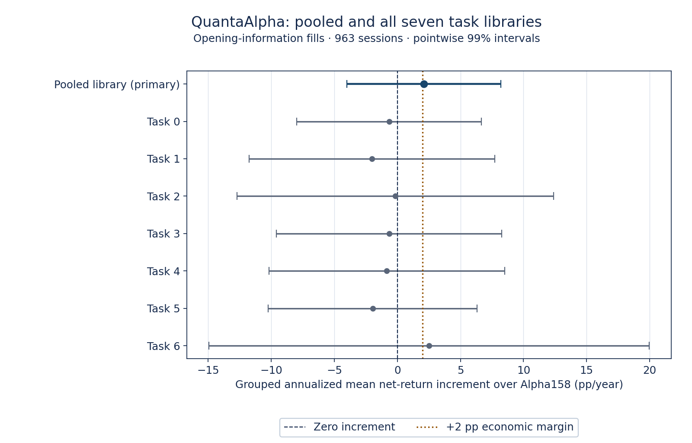
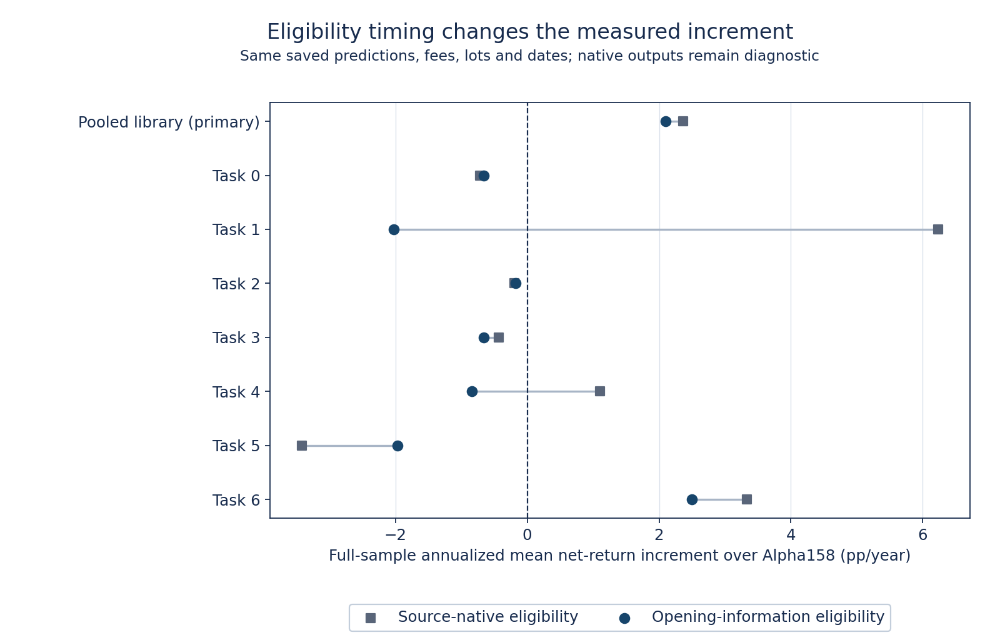

# QuantaAlpha later-period results — completed case, exploratory study

No significant incremental alpha is established. The pooled library adds **2.10 percentage points/year** over Alpha158 under opening-information eligibility, but its grouped 99% interval spans **-4.02 to 8.22 points**. The two-case conservative adjusted p-value is 0.278.

Across all seven individual task libraries, **6/7 underperform** Alpha158. Their median full-sample increment is **-0.66 points/year**; none has a positive interval and a corrected p-value below 1%. These are dependent source tasks on one market history, not seven independent market replications. The pooled feature union is a different fitted model, not an average of task portfolios.

## Fixed comparison contract

| Choice | Main analysis | Alternative and status |
|---|---|---|
| Features | Complete source-used pooled library over Alpha158 | All seven individual task libraries completed; secondary |
| Execution | Opening-information eligibility with uniform 9.5% proxy | Source-native eligibility retained as diagnostic |
| Portfolio | Released native Top50/drop5, source fees and lots | Same saved predictions across execution rules; no refit |
| Sample | CSI300 dated universe; 963 sessions, 2022-01-07 to 2025-12-26 | China comparison; no JKP132 attribution |
| Model/data lineage | Current served model and alternative archived data | Historical snapshots and pristine confirmation unavailable |
| Study completion | This pooled and seven-task Quanta case complete | Alpha20, separate Quanta paper-parameter sensitivity and final families pending |

## All libraries, retained without selecting a winner



| Library | Full-sample mean, pp/year | Grouped 99% interval, pp | Adjusted p* |
|---|---|---|---|
| Pooled library | +2.10 | [-4.02, +8.22] | 0.278 |
| Task 0 | -0.66 | [-7.97, +6.66] | 1.000 |
| Task 1 | -2.02 | [-11.75, +7.71] | 1.000 |
| Task 2 | -0.17 | [-12.72, +12.37] | 1.000 |
| Task 3 | -0.66 | [-9.58, +8.27] | 1.000 |
| Task 4 | -0.84 | [-10.18, +8.50] | 1.000 |
| Task 5 | -1.97 | [-10.26, +6.33] | 1.000 |
| Task 6 | +2.50 | [-14.95, +19.96] | 1.000 |

[Full comparison audit](visual_tables/comparisons_full_audit.csv). The plot centers each interval on its grouped estimate; the table reports the distinct full-sample mean. *The pooled row uses a conservative two-primary-contrast bound; task rows use the separate 54-contrast secondary-family bound. Those families remain partial while AlphaAgent is incomplete. Intervals are pointwise, not simultaneous.

## Opening information versus native eligibility



| Library | Native diagnostic, pp/year | Opening information, pp/year | Change, pp/year |
|---|---|---|---|
| Pooled library | +2.37 | +2.10 | -0.27 |
| Task 0 | -0.71 | -0.66 | +0.05 |
| Task 1 | +6.23 | -2.02 | -8.25 |
| Task 2 | -0.20 | -0.17 | +0.03 |
| Task 3 | -0.43 | -0.66 | -0.23 |
| Task 4 | +1.10 | -0.84 | -1.94 |
| Task 5 | -3.42 | -1.97 | +1.45 |
| Task 6 | +3.33 | +2.50 | -0.83 |

[Full comparison audit](visual_tables/comparisons_full_audit.csv). These are arithmetic-mean differences after costs. Source-native Qlib uses same-day change and closing-price missingness to gate open fills. The opening variant uses finite positive current open and prior close, with byte-identical saved predictions/labels and identical portfolio rules. It remains a uniform proxy, not exact board-specific auctions, liquidity, impact or point-in-time adjustment history.

## Source4 and inference boundaries

Both Source4-baseline contrasts are retained in the full audit table. They are secondary and do not substitute for Alpha158 attribution. The economic primary is the pooled opening-information increment over Alpha158; no task is promoted after seeing returns.

Inference uses four contiguous time blocks, 99% pointwise intervals and a 1% family threshold. The original stationary-bootstrap results remain diagnostic after synthetic short-sample undercoverage. Grouped-method calibration covered eight specified data-generating/sample cells, not every financial process; approximate independence and normality of block estimates remain assumptions. Degenerate comparisons contribute p=1 to family adjustment. Current library/endpoint/data choices make this exploratory historical analysis.

The annualized mean equals 252 times a daily arithmetic mean. Grouped intervals cover that estimand, not geometric growth. Any underlying `cagr` field denotes 252-session geometric annualization, not calendar-time CAGR. Finite model inputs do not erase separately flagged raw-factor infinities. Information boundaries and full-universe factor checks establish specific causal-input properties, not historical model-knowledge purity.

## Replication and publication status

The bounded released-default Quanta source, full cached replay, seven source accounts, sixteen source-used program proofs, eight pooled later-period accounts and twenty-eight task-level later-period accounts have completed their respective checks. These counts are execution evidence, not full-paper reproduction. The factor YAML was inactive; actual constructor/prompt settings and the separately pending paper-parameter variant are documented in the source review packet. Missing historical model/data/seed/zoo lineage and structured segment splicing remain gaps.

All 69 papers keep distinct evidence and limitations. No significant JKP132 alpha, pristine confirmatory result, independent human review, final full-study archive, or full-paper reproduction is claimed by this report.

## Evidence and reproduction

[Report verification](validation.json) · [Source lineage](lineage.json) · [Source review packet](../SOURCE_REVIEW_PACKET.md) · [Current project status](../STATUS.md) · [Full comparison audit](visual_tables/comparisons_full_audit.csv)

The builder verifies source output hashes, resolves exact executed analyzer snapshots, and recomputes all 32 comparison means, intervals and p-values from their paired daily net returns before drawing figures. It never trains a model or makes an API call.

From the canonical Bouchet checkout:

```bash
/nfs/roberts/project/pi_btk22/zc362/environments/venvs/alpha-agent-replication-py312-20260813/bin/python scripts/build_quanta_results_report_v2.py
```
