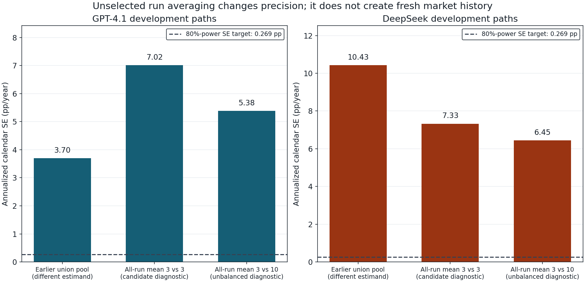
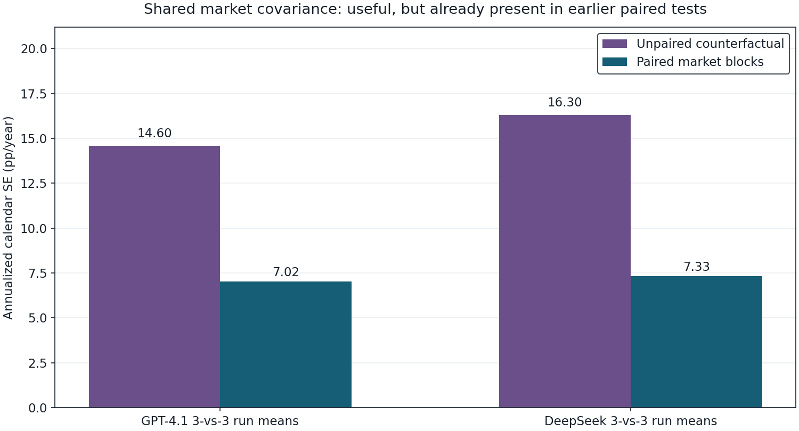

# Paired design and fresh-data readiness

**The research search remains unlaunched.** This version tested a concrete development change at unchanged per-run exposure: average all recorded algorithm replicates instead of forming a union factor library. It also checked the source dataset's date metadata without fetching new outcome rows. Temporal precision alone is still insufficient in at least one reference backend under the previous 99%-interval/+2-pp/80%-power criterion; joint future-search uncertainty and fresh confirmation-data readiness are not established.

## What averaging changes

| Reference | Union-pool SE | 3-vs-3 run-mean SE | 3-vs-10 diagnostic SE |
| --- | ---: | ---: | ---: |
| GPT-4.1 | **3.696** | 7.017 | 5.384 |
| DeepSeek | 10.433 | 7.328 | **6.449** |

All SEs are annualized percentage points; lower is better for diagnostic precision and bold marks the lowest value in each row, including ties. The estimands differ, and the 3-vs-10 control is unbalanced; no value is promoted as the best strategy or used to choose a backend. Per-run exposure/cost accounting is unchanged. The run-mean statistic is expected replicate-month performance, not a newly backtested rebalanced investable portfolio. [Full variant table](visual_tables/precision_variants.csv).

## Pairing is already in the old comparison

| Reference | Unpaired diagnostic SE | Paired SE | Block correlation |
| --- | ---: | ---: | ---: |
| GPT-4.1 | 14.600 | **7.017** | 0.770 |
| DeepSeek | 16.299 | **7.328** | 0.808 |

Lower SE is better; bold is the lower value in each row. The unpaired case is an explanatory counterfactual. The original pooled EFS tests already used matched market dates, so this covariance reduction cannot be credited as a new improvement over V1. Correlation is descriptive, without a better/worse ranking. [Covariance audit](visual_tables/pairing_covariance.csv).

| Reference | 3-vs-3 detectable separation | 3-vs-3 conditional power | Temporal target reached? |
| --- | ---: | ---: | --- |
| GPT-4.1 | 52.21 pp/year | 0.82% | No |
| DeepSeek | 54.53 pp/year | 0.81% | No |

These are conditional four-independent-normal-block calculations at 72 months, using the same +2-pp separation from the worthwhile boundary as V1. Larger power is better, but neither backend is selected from these development outcomes. Full future-search uncertainty is not covered by this calendar SE. The required SE is 0.269 pp/year. [Power inputs and outputs](visual_tables/precision_variants.csv).

## Seed labels do not manufacture independent information

All six matchings of three grammar runs to three LLM runs were evaluated. The mean contrast is numerically invariant, as the algebra requires. Choosing a favorable matching cannot improve its mean time-path precision. Real common-random-number coupling needs genuinely shared evaluator/split/random inputs; a matching integer label does not supply it. [All pairings](visual_tables/all_seed_pairings.csv).

Exploratory two-way variance components use only three seeds and four time blocks. Negative component estimates are retained, not clipped; projections from invalid components remain unavailable. Even admissible components rely on strong exchangeability/independence assumptions and do not certify future seed/time power. No hypothetical 10/30/100-seed row opens a search gate. [Components](visual_tables/exploratory_variance_components.csv), [conditional projections](visual_tables/seed_count_projections.csv).

## Confirmation data

The existing saved aggregate paths cover 2019-2024 and are already inspected development evidence. The source extract manifest spans 2018-10-01 to 2024-12-31 and discloses a static 50-name universe. The underlying source parquet footer reports 1913-07-24 through 2028-12-01; a date range or existing file does not prove non-use. The audit read footer statistics only, not candidate new outcome rows. No globally exhaustive dataset inventory or pristine historical-model claim is made. [Readiness table](visual_tables/validation_data_readiness.csv).

A metadata plausibility check found 74 of 1891 row groups with upper dates later than November 1, 2026. No whole row group is entirely in the future, and no new outcome rows were read. The footer maximum of 2028-12-01 is not evidence that genuine future market observations exist. Sentinel, parsing, projection or other provenance explanations are unresolved; none is asserted. The bounded 2019-2024 saved extracts remain unchanged and are not invalidated by this metadata-only finding. [Data-readiness finding](data_readiness_findings.json).

[PAIRED_DESIGN_AND_DATA_PLAN.md](PAIRED_DESIGN_AND_DATA_PLAN.md) specifies the actual acceptance checklist. A forward period can start only after a completed executable-policy/input/selection seal, not after this Markdown draft or a retrospectively chosen date. Exact provider/input/model identities, data rights, point-in-time rules, independent accounting and sufficient duration must be established. New seeds and a shorter prospective pilot do not replace missing market information.

## Decision and continuation

The [development decision](development_decision.json) keeps the launch gate closed. This is a measured design/readiness result, not an economic alpha-null finding. The candidate must satisfy both the seed/time precision requirement and the confirmation-data contract before paid or scientific search execution. A later alternative primary endpoint, lower margin, weaker confidence level, favorable backend/seed subset or active-exposure shrinking cannot be introduced silently to reverse this result.

No LLM request, factor generation, model fit, backtest, original source/replay/account/analysis helper or held job was run or changed. The current project commitment remains $371.06592557; the canonical ledger and all bound source files are unchanged. Existing source-search budgets were not equal in every respect, so these diagnostics do not identify an isolated LLM causal effect.

## Sources, lineage and reproduction

The [diagnostic protocol](diagnostic_protocol.json) fixes the variants and all-seed checks. Saved inputs and hashes, private centered diagnostics, dataset metadata, numeric validation and file readbacks are retained under `artifacts/llm_factor_value_v2_20261101`. New output is separate from V1 and all earlier studies.

Method references: [common random numbers](https://pubsonline.informs.org/doi/10.1287/opre.39.4.583), [adaptive holdout reuse](https://arxiv.org/abs/1506.02629). Neither makes an already inspected holdout fresh or establishes independence of this market path.

Builder: central `environments/bin/alpha-evolve-python artifacts/llm_factor_value_v2_20261101/analyze_pairing.py`. It refuses an existing start receipt. Reproduction requires a separately versioned output and recorded protocol amendment; preserve this completed version. Run `review_and_finalize.py` only in a fresh version after preserving its bound metadata diagnosis; it adds the date-plausibility context, checks numeric identities and saved report readback, and finalizes this new diagnostic. Canonical audit files are in `visual_tables/`, figures in `visual_figures/`, and the no-image report is `REPORT.md`.
