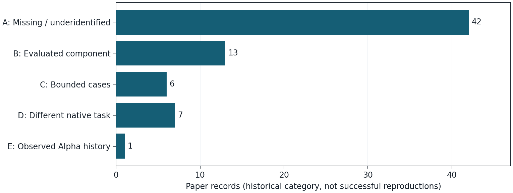
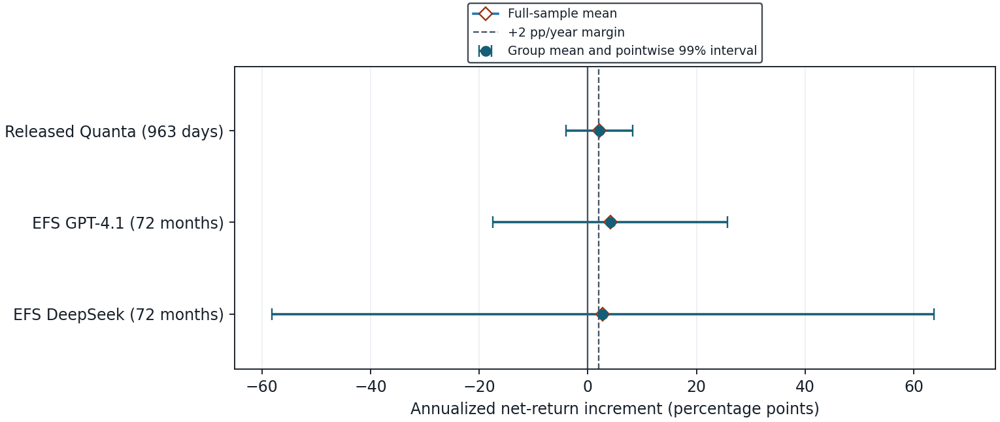
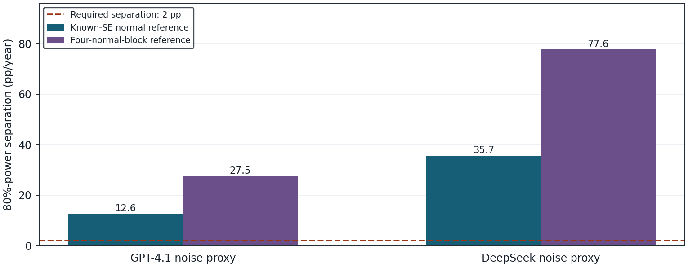
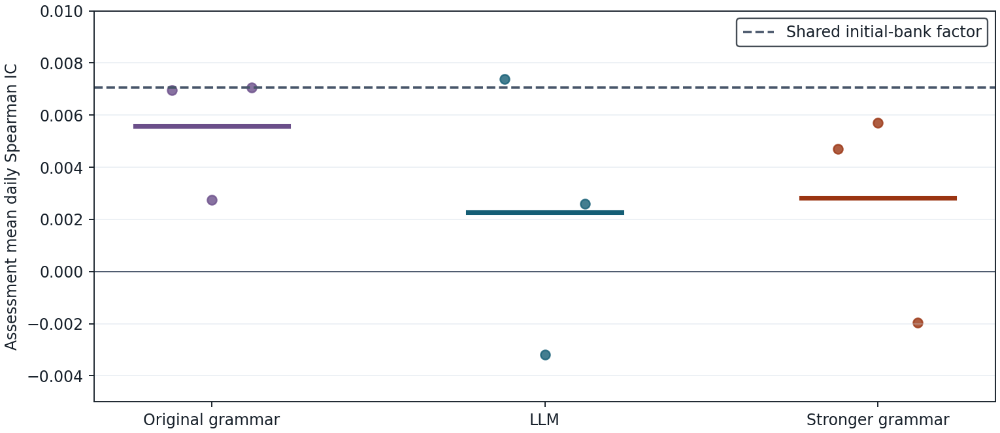

# From Executable Agents to Investment Evidence

## A 69-Paper Audit, Bounded Economic Evaluations, and a Controlled Discovery Pilot

Working paper | November 5, 2026 | Draft for substantive human review

### Abstract

LLM investment studies make claims at several evidentiary levels: executable mechanisms, reproducible computations, predictive signals, and economic alpha. We investigate how these levels connect using a purpose-built collection of 69 paper records, bounded native or adapted executions, and a small controlled factor-discovery pilot. Our effort establishes no full original-paper reproduction, but this does not turn unavailable experiments into negative performance observations. The three available contrasts in a four-case economic family have wide pointwise 99% intervals; the missing strict AlphaAgent comparison remains missing. Using archived noise estimates, a six-year design has only 0.7%-2.1% conditional power to resolve a two-percentage-point annual separation from a prespecified economic boundary. We therefore distinguish that unresolved economic question from a newly executed process experiment. In three search seeds with 48 proposal slots per arm, GPT-4.1 produces mean later-period rank IC of 0.00227, compared with 0.00559 for adaptive grammar search, 0.00283 for a strengthened post-launch grammar sensitivity, and 0.00707 for a shared validation-selected initial factor. Twelve model calls cost $0.036072. Outcomes vary across seeds, all market history is development evidence, and no significance or no-alpha conclusion follows. The combined evidence locates two distinct limits: incomplete original experiment identity and inadequate economic precision. It also shows why proposal novelty, validation success, and exact replay are insufficient substitutes for incremental predictive or investment value.

Keywords: large language models; factor discovery; reproducibility; investment evaluation; statistical power. JEL: C18, C88, G11, G14.

## 1. Introduction

An investment agent can execute without demonstrating an investment advantage. Its recorded actions can replay exactly without reproducing the experiment that motivated it. Its factors can predict returns weakly without producing a profitable portfolio after realistic costs. These distinctions matter when assessing LLM systems that combine changing model endpoints, search procedures, stateful tools, and financial datasets.

We began with the practical ambition of reproducing a large collection of investment-agent papers and comparing their investment value. That effort generated substantial source audits, partial native results, adapted evaluations, and verified computational histories. It did not establish faithful reproduction of the entire reported experiment for any of the 69 paper records. Treating those unresolved cases as zero-alpha observations would answer a different question from the one actually studied.

This paper assembles the completed evidence and adds a deliberately small, controlled research-process pilot. Its organizing question is: at which stage does evidence cease to support the next stronger claim? We distinguish identity of the original experiment, repeatability of a recorded computation, predictive quality under an explicit replacement design, incremental net performance, and risk-adjusted alpha. The distinction is operational: each stage requires different inputs and a different denominator.

The first result concerns identification rather than performance. Code availability by itself is not a sufficient definition of a reproducible investment experiment. Data vintage, trained state, prompt and tool contracts, portfolio rules, repeated-run design, and version-specific result generators can remain unidentified even when meaningful source components exist. Conversely, partial recovery can be substantial. Recomputed baselines and author-output correspondence deserve credit without being relabelled as regenerated LLM decisions.

The second result concerns the interpretation of negative evidence. Completed bounded economic evaluations do not establish a general absence of alpha. The available primary intervals admit both losses and economically relevant gains. A planning calculation using the archived EFS noise scale shows why: a six-year paired history is much less precise than the two-percentage-point decision requires under the stated inference models. This is a diagnostic of the proposed design, not a universal impossibility result for financial inference.

The third result is a local process comparison that actually executes new proposals. We hold a restricted factor language and evaluator fixed, compare LLM proposals with adaptive grammar proposals, retain invalid and duplicate attempts, and assess a validation-selected factor on a later historical period. The LLM does not lead either grammar comparator on average assessment IC. A simple initial-bank factor exceeds all three arm averages. A stronger control removes an apparent novelty advantage, while its own validation gains fail to translate into a clear assessment advantage. These outcomes suggest that comparator construction and selection overfit deserve at least as much attention as generative novelty.

Our contribution is thus an integrated empirical record with explicit claim boundaries, rather than a census of failed alpha claims. The 69 records are not a random sample of the literature, the economic cases are not representative draws, and the process pilot is not a confirmatory test. We report those limits because they determine what the measured results mean, not merely as qualifications appended to a stronger headline.

## 2. Related work and the objects being reproduced

LLM-based financial research spans distinct mechanisms. FinMem combines layered memory and character design [1]; FinAgent adds multimodal intelligence and reflection [2]; TradingAgents coordinates specialized decision-making roles [3]. AlphaAgent and QuantaAlpha use LLM-guided factor search with regularization or trajectory-level evolution [4,5]. EFS motivates language-guided evolution for sparse portfolio selection [6]. Our restricted process pilot does not reproduce these full architectures. It tests one component-level proposition: the value of the proposal engine within a common small expression space.

The broader asset-pricing literature already treats selection and multiplicity as central to evaluating discovered factors. Harvey, Liu, and Zhu [7] explain why a large search changes the interpretation of conventional significance. Bailey and coauthors [8] study backtest overfitting. Jensen, Kelly, and Pedersen [9] provide a different perspective on factor replication and substantial shared infrastructure. We use CRSP-derived JKP inputs in parts of the project, but our results are not a replication of their global factor study. These contributions motivate reporting the search process and sample construction rather than interpreting a selected strategy's point estimate in isolation.

Schwartz, Andrews, and Shapiro [10] organize an LLM workflow around published economics replication packages. That setting starts from a package intended to map an article's computations to its reported outputs. Our exercise frequently has to establish that mapping before it can attempt an economic comparison. We use their distinction between reproduction, implementation improvement, and extension as motivation, not as a benchmark success rate: our inherited investment corpus and their replication-package population have different selection and access conditions.

Temporal-group inference [11] and adaptive data-analysis work [12] clarify further limits. Splitting a return history into groups does not make every dependence structure innocuous. Reusing an assessment history while designing new procedures does not produce a fresh holdout merely because the new code has not yet scored it. The present manuscript preserves both distinctions. It does not apply a reusable-holdout procedure retroactively or claim general validity of a four-group approximation.

Table 1. Evidence objects and their permissible interpretation

| Object | What can be established | What it cannot establish alone |
| --- | --- | --- |
| Source component | An attributable mechanism exists or executes | The complete reported experiment |
| Author-output readback | Stored outputs match a reported number | Regeneration of decisions or discovery |
| Exact cached replay | Our recorded computation is repeatable | Original model/data equivalence or alpha |
| Bounded adapted experiment | Performance of the stated replacement design | A full-paper replication |
| Controlled discovery comparison | Local incremental predictive/process quality | Profitable tradable performance |
| Economic evaluation | Net-return differences under declared accounting | Unrestricted alpha or practical equivalence |

## 3. Audit design, scope, and evidence accounting

### 3.1. Corpus and unit of analysis

The unit is a paper record in an inherited 69-record, 67-system-lineage collection assembled for the project. The common-transfer protocol fixed a monthly U.S. top-1,000-stock JKP evaluation task, with August 1999-December 2024 realization months and a stated cost and benchmark contract. This was a purposeful common-data exercise, not an exhaustive, prospectively sampled survey of all LLM-finance research. Appendix A lists every full title. Linked audit records preserve the version identities and paper-specific gaps.

The project subsequently expanded selected recoverable native mechanisms and created an explicitly labelled in-spirit reconstruction layer. Those stages must not be pooled as if they were one unchanged protocol. The common-task ledger contains one adapted and 16 partial evaluated cases, plus 52 non-evaluable common-task records. The in-spirit stage carries those 17 common evaluations, adds 45 researcher-supplied reconstructions, and excludes seven structural task mismatches. None of these arithmetic closures creates a faithful original-paper reproduction. We retain them to describe the path of the investigation, but do not use surrogate returns to test the authors' native strategies.

Audit operations include paper and source identification, available artifact inspection, bounded component checks, comparison of released outputs with displayed results, and documentation of missing or conflicting method objects. The operative record includes its dates. The October 1 refresh covers 42 historically missing or underidentified cases through bounded exact-name searches, with direct default-head checks for 17 named repositories; it is not a new exhaustive review of all branches and forks. No full November 5 availability recrawl was performed for this manuscript.

Table 2. Historical audit routing categories

| Code | Category | Records |
| --- | --- | --- |
| A | Missing artifacts / underidentified policy | 42 |
| B | Evaluated source component; full mechanism unreplicated | 13 |
| C | Bounded native/adapted or preserved cases | 6 |
| D | Outside the common monthly U.S./JKP task | 7 |
| E | Observed Alpha history; strict experiment unavailable | 1 |

[Full audit table](audit_tables/corpus.csv)

### 3.2. Preserving partial successes and scope failures

Forty-two records were routed as missing artifacts or underidentified policies, 13 as evaluated source components without a complete mechanism, six as bounded native/adapted or preserved cases, and one as the observed-history AlphaAgent case with its strict experiment unavailable. Seven records are excluded from the monthly U.S./JKP transfer task. These categories were inherited from a dated review workflow and do not exhaust all forms of native partial evidence. In particular, a task-transfer exclusion does not imply that the method fails on cryptocurrency, event data, or its original frequency.

Native examples show why an aggregate unavailable count is inadequate. The CryptoTrade audit recomputes 174 of 180 traditional-baseline cells and corroborates part of the coauthor LLM action histories, while leaving model/asset/period conflicts and a look-ahead-affected LSTM experiment unresolved. FinRL-DeepSeek supplies data and paper-relevant checkpoints that execute, but the recorded native metrics do not reproduce the paper's displayed values under the inspected protocols. The R&D-Agent record concerns a general MLE-Bench report rather than the separate quant application; quant code cannot validate the reported competition experiment. These are different evidentiary outcomes, not interchangeable failed investment tests.

Availability is also a moving target. The October refresh finds that Alpha-R1 has a September paper revision and official implementation/model release, unlike the old README-only state. The historical original-version finding remains intact, while the new revision becomes a reassessment candidate. It is not promoted to a reproduced paper by code or weight-file presence. Our zero-full-paper count means that no complete original experiment has been established by this effort under its requirements; it does not establish an enduring impossibility for those papers or all future releases.

For each record, we keep original-task requirements separate from demands introduced by the common monthly benchmark. A paper need not provide a rule for combining 1,000 stock agents to be reproducible in its own single-asset task. Conversely, supplying such a portfolio adapter does not make the adapted evaluation the author's native experiment. This separation prevents the common benchmark from creating artificial replication blockers.

### 3.3. Failed and incomplete work as part of the denominator

Attempts, interrupted histories, unavailable inputs, and missing comparisons remain in the record. Source or model failures are not silently turned into zero returns, and completed prefixes are not counted as new independent trials when a continuation succeeds. The project stores both successful and failed versions of wrappers and checks, along with the inputs and exact output identities needed to distinguish them.

This preservation supports computational auditability, but not a measurement of human replication effort. The effort review finds 34 narrative per-paper effort records and 205 distinct selected scheduler allocations. The narratives do not contain measured labor or debugging hours; the allocations cover only selected execution and include failures and shared storage work. Summed concurrent allocation time is neither elapsed project time nor human effort. Accordingly, time to faithful reproduction is unavailable for all 69 records. We cannot use infrastructure runtime as an estimate of how long a typical paper takes to replicate.

## 4. Bounded economic evidence

### 4.1. Designs and information boundaries

The economic evidence consists of several distinct case studies rather than one homogeneous sample of strategies. The expanded FinMem, FinAgent, and TradingAgents work uses dated adapted inputs and native or explicitly modified decision workflows. The EFS comparison is a paper-guided U.S.50 implementation; attributable original EFS author implementation was not recovered. Quanta executions preserve released-source machinery and separately declared paper-parameter settings. Historical endpoint snapshots and parts of the original data lineage remain unavailable.

Alpha generation is physically bounded to five OHLCV fields through January 2, 2025; the later exploratory account has 238 sessions and a first signal/fill on January 3/6. Quanta generation uses six fields through January 5, 2022; its later account has 963 sessions and first signal/fill on January 6/7. Full-universe program diagnostics remove actual future rows at historical cutoffs and compare native matrix identity. They test the consumed programs' data dependence, not whether the pretrained LLM had historical financial knowledge. Evaluation HDFs were not supplied as generation inputs.

Execution clocks are economically material. The native Qlib opening-eligibility rule uses same-day closing-change and missingness information. A declared opening-information proxy instead uses finite positive current open and prior close with the same 9.5% threshold, preserving saved predictions, labels, fees, lots and dates. An audit finds 433 buy and 181 sell eligibility discrepancies on 72,964 stock-days in 2019. The proxy is an information-boundary sensitivity; board rules, auctions, liquidity and adjustment vintage remain incomplete. It is not exact Chinese-market execution.

Raw nonfinite values are retained even when processed model matrices are finite. The observed Alpha library contains five infinite cells from two programs; the Quanta parameter library contains 32,359 infinite cells in seven membership-filtered columns. Twelve whole-universe program flags concern a different Quanta scope and cannot be added to the seven columns. Deleting flags after preprocessing would erase rather than resolve a source property.

### 4.2. Available primary comparisons

Let d(t) denote an LLM-system net return minus its matched reference return. The reported annualized mean increment is frequency times the mean paired difference. EFS first compounds daily returns within each month and uses frequency 12; Quanta uses daily differences with frequency 252. These are different estimands and markets, so their rows are not replications of one common treatment effect.

The inference record uses four contiguous groups and a Student-t reference with three degrees of freedom. The group-mean estimator and the full-sample estimator differ when block lengths differ. We retain both. Pointwise 99% intervals are not simultaneous practical-margin bounds; dependence and approximate-normality requirements remain assumptions, with retained small-sample calibration diagnostics. We do not borrow daily-sample calibration to certify monthly N=72 inference.

The original v2 economic family contains strict Alpha, released Quanta, and two EFS pool comparisons. Only three are available. The absent strict Alpha case stays in the denominator of four; we report the conservative four-times-p bounds instead of applying a three-case Holm procedure. The exploratory observed-history Alpha sensitivity cannot fill the missing original design.

Table 3. Available primary contrasts; annualized percentage points

| Case | Full mean | 99% group interval | Raw p | 4-case p bound |
| --- | --- | --- | --- | --- |
| Released Quanta | +2.096 | [-4.021, +8.217] | 0.1390 | 0.5559 |
| EFS GPT-4.1 | +4.128 | [-17.462, +25.718] | 0.3455 | 1.0000 |
| EFS DeepSeek | +2.729 | [-58.209, +63.667] | 0.8106 | 1.0000 |

[Full audit table](audit_tables/economic_primary.csv)

All three intervals include both zero and economically meaningful positive increments, and all adjusted positive-increment flags are false. The appropriate conclusion is inconclusive at the two-percentage-point annual margin. Neither non-significance nor an unavailable fourth experiment establishes no alpha, practical equivalence, or a zero expected effect.

The EFS construction pools three trajectories per backend and compares causally available libraries with three fixed grammar trajectories. The recorded libraries contain 1,104 grammar, 1,820 GPT-4.1, and 2,198 DeepSeek functions. Library size is a workflow outcome, not an independent-success count. Twenty-four cost/mode paths cover 1,510 days and 72 months, with independent account differences no larger than 9.35e-16. At the primary 10-bp cost, the full-sample increments are +4.128 and +2.729 percentage points per year. The intervals are much too wide for a strong economic conclusion. Grammar's restricted hypothesis space and differing realized admissible counts also limit interpretation as an isolated LLM effect.

Risk-adjusted attribution is a separate question. An unrestricted intercept plus 133 factor coefficients is not identified on 72 months. The project refuses to obtain an unrestricted alpha by pseudoinverse. A six-factor diagnostic and expanding 36-month ridge/PCA reconstructions are retained with their limited meanings; using contemporaneous factor returns makes those reconstruction diagnostics, not tradable forecasts. Missing factor turnover, financing and allocation costs preclude net-fund or efficient-frontier claims.

### 4.3. Supplementary histories and descriptive equity accounts

Table 4. Supplementary opening-information comparisons; not replacement primaries

| Case | Sessions | Full mean pp/y | 99% group interval |
| --- | --- | --- | --- |
| Observed Alpha / opening / Alpha158 | 238 | -13.557 | [-46.893, +19.782] |
| Quanta parameters: source4 | 963 | +4.083 | [-25.938, +34.119] |
| Quanta parameters: alpha158 | 963 | +3.776 | [-15.763, +23.335] |

[Full audit table](audit_tables/supplementary_economics.csv)

The observed Alpha sensitivity retains all 20 outcomes, 96 attempts, four unattempted rounds and 86 histories. Two early-abort cases cannot satisfy the original 20-trial by five-round experiment. No missing response or round is imputed. Its negative point estimate therefore belongs to a separate exploratory observed-history comparison, not the original strict primary. Similarly, Quanta parameter changes jointly affect several settings and the model route; they are not isolated causal parameter effects. All supplementary intervals remain inconclusive at the stated margin.

The equity execution record contains 3,877 newly validated replay records. These comprise 1,648 FinMem additions, 183 TradingAgents records, a separate 61-record news sensitivity, and 1,985 FinAgent records. The main 13-source population is 4,354 because it includes 538 earlier FinMem records and excludes that separate sensitivity. A workflow record is not an independent return observation. All 13 source/account checks pass, with maximum independent account discrepancy 5.551e-16, but exact financial accounting does not create a treatment contrast that the design did not specify.

Table 5. Within-study descriptive terminal wealth; initial wealth one

| Study | Sessions | Window | Agent | Matched buy-hold |
| --- | --- | --- | --- | --- |
| FinMem | 127 | 2022-10-06 to 2023-04-10 | **1.101298** | 1.090175 |
| TradingAgents | 61 | 2024-01-02 to 2024-03-28 | **1.084726** | 1.076676 |
| FinAgent | 147 | 2023-06-01 to 2023-12-29 | 1.009548 | **1.136907** |

[Full audit table](audit_tables/equity_accounts.csv)

Higher terminal wealth is better; bold marks the winner within each row, including ties. Accounts allocate equal initial capital to assets and then drift without daily cross-account rebalancing, with next-close execution and a 10-bp cost setting. Different dates and assets forbid cross-study ranking. FinMem's higher terminal wealth coexists with a lower annual arithmetic mean than its control, and both quantities are preserved. One trajectory per asset does not reproduce the papers' repeated-trial experiments. A separately settled prospective observation supplies only one outcome, with no significance inference.

## 5. What the economic design could resolve

Before launching another discovery experiment, we asked a decision-specific planning question. Let the worthwhile-improvement boundary be delta = 0.02 per year. Using a 99% interval, a lower bound above delta would support a worthwhile gain in the named scope; an upper bound below delta would rule out that particular positive margin. An interval crossing delta is inconclusive. Ruling out delta is not equivalence around zero, and our calculations do not establish absence of alpha.

For planning, consider true increments zero and 0.04. Each lies 0.02 from the decision boundary, so either direction requires resolving a two-percentage-point separation. We use archived EFS standard errors as development noise proxies rather than as a guarantee for a new search process. A known-standard-error normal reference is deliberately optimistic. A second reference assumes four independent normal block estimates and uses noncentral-t power with three degrees of freedom. The analytic preview already inspected during design is disclosed in the protocol; the exercise is not called a retrospectively blind preregistration.

Power reference: Pr[T > c] = 1 - Fnct(c; 3, a / SE), where c = t3,0.995 and a = 0.02.

Table 6. Six-year conditional precision; SE and separations in pp/year

| Noise proxy | SE | Normal MDE | 4-block MDE | Normal power | 4-block power |
| --- | --- | --- | --- | --- | --- |
| GPT-4.1 proxy | 3.696 | **12.63** | 27.50 | **2.09%** | 1.25% |
| DeepSeek proxy | 10.433 | **35.65** | 77.63 | **0.86%** | 0.70% |

[Full audit table](audit_tables/power_reference.csv)

Lower detectable separation and higher power are better; bold marks within-row winners. The models are reference assumptions rather than competing estimators selected by their favorable output. The 0.7%-2.1% power range is far below the 80% target. Fifty-thousand-replication simulations per reference/effect point agree with the independent-normal calculation. Gaussian, serially correlated, heavy-tailed and variance-shift stress scenarios remain diagnostics, not validation under every financial process. The earlier approximate t-plus-normal MDE is kept in historical results but is not substituted for this conditional noncentral-t calculation.

A follow-up precision diagnostic averages all recorded run-level monthly performance rather than pooling factor libraries. At unchanged per-run exposure, the three-versus-three average has temporal SEs about 7.02 and 7.33 percentage points per year. This is an expected-replicate-performance statistic, not a newly backtested investable ensemble, and differs from the original union-library strategy. All six pairings of three grammar seeds give the same average contrast. Seed labels cannot manufacture common random numbers or independent market histories. With only three search seeds and four blocks, exploratory variance-component projections cannot certify full future-search uncertainty.

Data readiness remains a separate condition. The inspected histories cannot be renamed an unused confirmation set. Source-footer metadata also include upper dates later than the November 1 inspection date; metadata alone do not identify the reason and do not demonstrate genuine future observations. Only footer statistics were read in that diagnostic. The earlier bounded 2019-2024 extracts are unchanged and are not invalidated by this metadata finding. A new prospective experiment needs a completed executable-policy and input seal before its first observation, plus a sufficient horizon. No such confirmation test was launched.

These results explain the decision to stop that proposed economic test, not to stop all LLM research. They also motivate a deliberate change in question: measure the local research process under a fixed budget, report predictive quality descriptively, and avoid turning an underpowered economic result into a no-alpha claim. The process pilot below was explicitly authorized under this revised scope.

## 6. Controlled discovery-process pilot

### 6.1. Common language, data and target

The pilot uses the saved split-adjusted-close U.S.50 input extract and its bound data manifest. The static legacy universe and previously inspected history make it a development benchmark. Inputs to factor expressions are strictly trailing price transformations. The twelve terminals are momentum over 1, 5, 10, 20 and 60 sessions; daily price-return volatility over 5, 10, 20 and 60 sessions; and price relative to a trailing moving average over 5, 20 and 60 sessions. Permitted operators are negation, current cross-sectional percentile rank, addition, subtraction, and multiplication. Expressions have depth at most four and at most 15 nodes.

A safe syntax parser accepts only those named terminals and operator calls; no generated Python is evaluated or executed. Features use no forward filling from future rows. The target is the product of one plus dividend-inclusive returns over the next five sessions minus one. This is a predictive label, not a claim that a position can earn that path under the portfolio clocks used elsewhere. Target horizons must end within the scored split; rows crossing split endpoints are purged. Daily Spearman IC uses finite feature/label pairs with at least 20 stocks and records coverage. The future-label mask affects scoring, never the factor input or historical feature construction.

Label: Yi,t = productk=1,...,5(1 + Ri,t+k) - 1. Daily IC = SpearmanCorri(s fi,t, Yi,t).

Table 7. Pilot contract fixed before model calls

| Choice | Specification |
| --- | --- |
| Search replication | Three seeds: 101, 102, 103; four rounds per arm |
| Proposal opportunity | 12 emitted slots per round; 48 per arm/seed |
| Shared initial bank | All twelve terminal factors, present for every arm |
| Training and sign | 2019-2020; orientation chosen once from training mean IC |
| Validation selection | 2021; maximum mean IC among eligible initial and proposed factors |
| Assessment | 2022-2024; same fixed sign, no assessment feedback |
| Eligibility | At least 95% scored-date coverage |
| Validation hit | New valid/unique factor with oriented IC at least 0.01 and coverage at least 95% |
| Model route | GPT-4.1, OpenAI through OpenRouter, fallback disabled; temperature 0.3 |
| Budget | 12 maximum paid calls; $5 study ceiling; actual cost $0.036072 |

### 6.2. Proposal engines, feedback and selection

The original comparison has two arms: an adaptive grammar controller and GPT-4.1 proposals. Round one grammar expressions are random legal constructions. Later rounds use training-ranked mutation/crossover parents for 75% of proposals and fresh constructions for 25%, with up to six elite parents. The LLM receives the same type of terminal definitions, operator limits and training-parent summaries, plus its own invalid/duplicate counts. It receives no validation or assessment score, ticker identities, raw security-level data or investment dates. Different proposal streams are not claimed to be common-random-number coupling simply because seed labels are paired.

Every emitted slot is retained. Invalid syntax, missing or truncated response items and duplicate proposals consume slots without a replacement paid call. Canonical expressions detect structural duplicates; identical oriented training-prediction rank fingerprints detect a further class of non-novel factors. The reported novelty measure is therefore operational rather than semantic novelty, and not an originality claim relative to the financial literature. No equivalence test over every possible future input is asserted.

A training sign is learned for each factor before validation and remains fixed thereafter. At the end of 48 slots, validation selects the eligible candidate with highest mean IC, breaking ties by canonical expression. The initial bank remains in that choice set, preventing search from being credited merely for replacing a stronger simple baseline. The later assessment evaluates the selected factor without reorienting its sign. The twelve requests are separate completed model calls through the canonical accounting route; there are no hidden retries or outcome-selected replacement seeds.

The primary process endpoint is mean assessment IC of the validation-selected factor, with all per-seed differences retained. Validity, novelty, validation-hit yield, tokens, provider dollars, evaluation counts and elapsed time are secondary descriptions. Equal emitted-slot ceilings do not imply equal effective unique evaluations, CPU effort or dollars. This is a proposal-budget comparison, not an experiment that simultaneously equalizes every computational resource.

### 6.3. Post-launch control-quality sensitivity

The first proposal-count inspection exposed a grammar handicap: the original constructor can emit standalone signs, ranks, or initial-bank terminals that are already equivalent or known. We preserved that arm. A separately recorded stronger controller uses binary-root combinations and bounded syntax-only construction rejection to avoid already emitted structures before a slot reaches evaluation. It keeps the same language, evaluator, training-parent policy and 48 emitted slots per seed. Up to 32 construction attempts per slot are retained with their time and counts; rejecting syntax is not extra return-score feedback.

This sensitivity was specified after first-seed proposal counts were inspected and before the assistant inspected the new assessment IC values. It is post-launch and exploratory, not a retrospectively preregistered primary. It adds no model calls. Both the original and strengthened controls are reported, with no discarded control selected by favorable assessment returns. Because proposal construction effort differs, even the sensitivity supports only a bounded emitted-opportunity comparison. The LLM's internal reasoning effort is not observed or matched to grammar CPU operations.

## 7. Discovery results

Table 8. Search results across three seeds; each arm has 144 emitted slots

| Arm | Assessment IC | Unique | Val. hits | Model cost | Seconds |
| --- | --- | --- | --- | --- | --- |
| Original grammar | **0.005589** | 70 | 20 | **$0.000000** | 2.70 |
| LLM | 0.002274 | 110 | 19 | $0.036072 | 127.53 |
| Stronger grammar | 0.002826 | **130** | **54** | **$0.000000** | **1.79** |

[Full audit table](audit_tables/pilot_summary.csv)

Higher IC, valid/unique proposals and validation hits are better; lower provider cost and elapsed time are better. Bold marks the best in each column, including ties. These columns measure different properties and do not define a composite winner. The shared initial-bank factor has assessment IC 0.0070655, exceeding all arm averages. The original grammar mean is 0.0055895, the LLM mean 0.0022742, and the strengthened grammar mean 0.0028263.

The LLM improves proposal novelty relative to the original controller, with 110 valid/distinct within-seed proposals out of 144 versus 70. But the strengthened controller has 130. These are summed within-seed counts and can repeat across seeds; global training-rank fingerprint counts are respectively 94, 67 and 126. Validation-hit counts are 19, 20 and 54. Thus generative diversity is neither the same as useful validation yield nor a guarantee of assessment performance.

The stronger control illustrates a second selection problem. It produces more factors that pass the fixed validation-hit threshold and higher selected validation IC in several runs, yet its mean later assessment IC is below the original grammar arm's. This is compatible with validation overfit, but the small pilot does not identify the cause. We do not promote the controller with the most validation hits as a superior investment method. We also retain invalid expressions, duplicate counts and the initial-bank choice rather than reporting only successful discoveries.

Table 9. Per-seed assessment IC and paired difference

| Seed | Original | LLM | Stronger | Initial | LLM - stronger |
| --- | --- | --- | --- | --- | --- |
| 101 | 0.006965 | **0.007395** | 0.004716 | 0.007065 | +0.002679 |
| 102 | 0.002738 | -0.003185 | 0.005710 | **0.007065** | -0.008894 |
| 103 | **0.007065** | 0.002612 | -0.001947 | **0.007065** | +0.004559 |

[Full audit table](audit_tables/pilot_pairs.csv)

Higher IC is better, with within-row maxima bolded across the four IC columns. The difference column is descriptive and not ranked across seeds. The LLM beats the original grammar in one of three seeds and the stronger control in two of three. Its larger negative difference in seed 102 leaves the mean below both controls. This asymmetry is why a count of wins and an average effect answer different questions. Three proposal seeds do not support a general statistical ranking; they share dates, stocks, labels, initial bank and evaluation machinery. We report neither a superiority p-value nor a confidence statement about economic alpha.

Twelve calls cost $0.036072, and the LLM arm takes approximately 127.53 seconds summed across its three runs. The original grammar takes 2.70 seconds and the stronger control 1.79 seconds in the measured execution. These are process observations on the current machine, excluding common data preparation. They include API latency in the LLM case, do not price CPU or labor, and are not a reproducible hardware benchmark. The small provider cost means dollars alone are not the main limitation here; the absence of a measured predictive advantage is more relevant to deciding whether to scale this particular setup.

The pilot therefore supplies a local negative comparative result: under the chosen close-price language, evaluator, data and search budget, LLM proposals do not have higher average later-period predictive IC than either adaptive control. It does not say that the LLM cannot discover any useful expression, that either control is globally optimal, or that language-rich investment research lacks value. It offers no economic return result because no new portfolio backtest was run.

## 8. Validation, transparency and limitations

Validation checks support implementation correctness within the tested scope. Seventeen preflight checks cover safe parsing, exact target construction, split-end purging, training-sign orientation, prediction-duplicate handling, feature prefix invariance, and isolation of assessment labels from search feedback. A synthetic constant-factor test exposed a floating-point degeneracy that was corrected before model calls; the failed preflight version is preserved. All nine selected-factor assessment scores were independently recomputed using direct five-day return products and SciPy Spearman correlation, agreeing within 1e-12.

All 432 emitted slots across the original comparison and strengthened sensitivity are accounted for. The validation-selected expression is checked against the recorded candidate table. Each of the twelve request envelopes matches its durable response-journal identity and serving constraints. A canonical-state fingerprint excluding only this new study verifies that earlier request entries and imported usage are unchanged. These checks concern record identity and accounting, not independent scientific judgment. Assistant review is not independent human review.

Several limitations determine the interpretation. First, corpus and execution selection are purposeful. The recoverable cases are selected partly by artifact feasibility; evaluating them cannot estimate the fraction of all published LLM systems with alpha. Original model and data substitutions may change a method's behavior in either direction. Missing experiments cannot be recoded as zero returns to manufacture a cross-paper null.

Second, historical information has been reused throughout the project. Chronological splits in the pilot protect its local search-feedback path but do not restore a pristine global holdout. The model's pretraining knowledge and the static universe remain additional information-boundary issues. Not sending ticker identities or dates is a useful restriction, not proof that the model has no financial prior or that the original sample selection is point-in-time.

Third, the pilot's language is narrow. Close-price momentum, volatility and moving-average distance offer little scope for a language model's document interpretation or semantic reasoning. The experiment is intentionally small enough to audit, but its external validity for unconstrained code generation, multimodal agents, financial-text extraction or richer search spaces is limited. The within-language fairness choice itself restricts the capability being tested.

Fourth, the original and strengthened control constructors differ in syntax rejection, and the stronger sensitivity is post-launch. The original result remains primary to the frozen comparison; the sensitivity shows that an apparent novelty advantage depends on comparator engineering. No claim of equal useful evaluations, equal reasoning effort or optimal tuning is made. Future comparisons should freeze credible adaptive controls before outcomes and report ablations that isolate where improvements arise.

Fifth, process quality and economic value are distinct. Rank IC is an average cross-sectional predictive statistic. It omits turnover, leverage, concentration, market impact, financing and risk pricing. The pilot cannot repair the underpowered economic study by silently renaming predictive IC as alpha. Conversely, the economic power diagnostic is conditional on particular noisy histories and reference assumptions. It is not a theorem that all two-percentage-point investment effects require impractically long samples.

Finally, release completeness is not publication certification. The September scientific archives and their independent file copies were verified, and this manuscript is a separate supplement rather than a rebuilt archive. Both original and backup files remain on the same JSS project allocation, without separate-allocation or off-cluster fault isolation. Current source availability is dated, author names and journal-specific declarations require substantive author review, and no external submission or human attestation is represented here.

## 9. Discussion and conclusion

The original ambition was broader than the evidence eventually obtained. The meaningful result is not that absent code explains absent alpha. Rather, the investigation identifies separate points at which claims become unsupported: the original experiment may not be uniquely specified; a computation may be repeatable but adapted; a return difference may be measured but too imprecise; or a proposal engine may produce more expressions without better later prediction.

The combination is useful because each layer rules out a misleading shortcut. Partial native success prevents a blanket claim that every paper is unusable. Wide economic intervals prevent a blanket no-alpha conclusion. The completed process pilot prevents the record from ending at artifact availability alone, but its small descriptive result prevents a universal verdict on LLM research. The stronger grammar sensitivity shows concretely that comparator quality can change a novelty narrative without establishing a stable predictive winner.

For future work, the evidence favors a mechanism-specific question with credible controls and a validation source whose information status is documented before access. A text-based information extraction study would test a different capability from the close-price formula grammar here and should be labelled as a new hypothesis. A fresh economic experiment needs adequate seed/time precision, actual unused data or a prospective policy seal, and complete execution costs. Simply increasing seeds on the same history or searching until one profitable variant appears would not solve those problems.

We close the present effort at its measured scope. There are zero established full original-paper reproductions in this 69-record project, three available but inconclusive economic primary contrasts out of four, and a completed low-cost discovery pilot with no average LLM predictive advantage over its grammar comparators. Those statements are narrower than an industry-wide absence of alpha. They are also more informative than a binary declaration that replication succeeded or failed: they state which computation was performed, which comparison was identified, what the observations show, and what remains unknown.

## Data, code, and research-assistance statement

The manuscript is generated from versioned, checksum-bound completed artifacts. The companion audit tables retain full numerical precision, all 69 titles, the pilot's individual arm/seed results, and the earlier economic intervals. Licensed security-level data, detailed holdings, raw model response bodies and request-accounting records remain private. Public-facing aggregate tables do not grant redistribution rights to the underlying datasets. The Appendix B evidence map identifies the relevant relative directories within the project snapshot.

LLM assistance was used in coding, source-audit drafting, report generation and manuscript synthesis, in addition to the explicitly metered proposal arm. Consequently the assistant-produced audit labels and narrative require substantive human review. The current draft does not claim blind adjudication, independent human review, or an audit of every possible repository or model. No new scientific run, request, fit or portfolio calculation was performed to prepare this paper; new computations are limited to source verification, formatting and presentation of saved metrics.

As of the manuscript's locked accounting read, total project commitment is $371.10199757 including retained historical uncertainty. This is broader than the $0.036072 marginal cost of the process pilot and excludes unpriced labor and infrastructure. Failed or uncertain historical charges are not refunded or repriced for presentation. The original ledger, completed source workflows and prior manuscripts remain unchanged.

## References

[1] Yu, Y., et al. (2023). FinMem: A Performance-Enhanced LLM Trading Agent with Layered Memory and Character Design. arXiv:2311.13743. https://arxiv.org/abs/2311.13743

[2] Zhang, W., et al. (2024). A Multimodal Foundation Agent for Financial Trading: Tool-Augmented, Diversified, and Generalist. arXiv:2402.18485v3. https://arxiv.org/abs/2402.18485v3

[3] Xiao, Y., Sun, E., Luo, D., and Wang, W. (2025). TradingAgents: Multi-Agents LLM Financial Trading Framework. arXiv:2412.20138v7. https://arxiv.org/abs/2412.20138v7

[4] Tang, Z., et al. (2025). AlphaAgent: LLM-Driven Alpha Mining with Regularized Exploration to Counteract Alpha Decay. arXiv:2502.16789v2. https://arxiv.org/abs/2502.16789v2

[5] Han, J., et al. (2026). QuantaAlpha: An Evolutionary Framework for LLM-Driven Alpha Mining. arXiv:2602.07085v3. https://arxiv.org/abs/2602.07085v3

[6] Luo, H., Zhang, Y., and Liu, C. (2025). EFS: Evolutionary Factor Searching for Sparse Portfolio Optimization Using Large Language Models. arXiv:2507.17211v1. https://arxiv.org/abs/2507.17211v1

[7] Harvey, C. R., Liu, Y., and Zhu, H. (2016). ... and the Cross-Section of Expected Returns. Review of Financial Studies 29(1), 5-68. https://doi.org/10.1093/rfs/hhv059

[8] Bailey, D. H., Borwein, J. M., Lopez de Prado, M., and Zhu, Q. J. (2017). The Probability of Backtest Overfitting. Journal of Computational Finance 20(4). https://www.davidhbailey.com/dhbpapers/backtest-prob.pdf

[9] Jensen, T. I., Kelly, B., and Pedersen, L. H. (2023). Is There a Replication Crisis in Finance? Journal of Finance. https://doi.org/10.1111/jofi.13249

[10] Schwartz, M., Andrews, I., and Shapiro, J. M. (2026). An LLM Workflow That Reproduces, Improves, and Extends Published Economics Research. NBER Working Paper 35782. https://www.nber.org/papers/w35782

[11] Ibragimov, R., and Mueller, U. K. (2010). t-Statistic Based Correlation and Heterogeneity Robust Inference. Journal of Business and Economic Statistics 28(4), 453-468. https://doi.org/10.1198/jbes.2009.08046

[12] Dwork, C., Feldman, V., Hardt, M., Pitassi, T., Reingold, O., and Roth, A. (2015). Generalization in Adaptive Data Analysis and Holdout Reuse. arXiv:1506.02629. https://arxiv.org/abs/1506.02629

## Appendix A. Complete 69-paper index

The record is the unit of this appendix. Categories A-E refer to Table 2, retain their historical dates, and do not rank native reproducibility or investment value. Zero records are certified as full original-paper reproductions. Full native requirements and source identities are provided in audit_tables/paper_fidelity_matrix.json and corpus.csv. Titles are retained in full, including historical wording.

Table A1. All paper records

| ID | Full title | Cat. |
| --- | --- | --- |
| M001 | GPT-Signal: Generative AI for Semi-automated Feature Engineering in the Alpha Research Process | B |
| M002 | CryptoTrade: A Reflective LLM-based Agent to Guide Zero-shot Cryptocurrency Trading | D |
| M003 | Can Large Language Models Mine Interpretable Financial Factors More Effectively? A Neural-Symbolic Factor Mining Agent Model | A |
| M004 | FLAG-TRADER: Fusion LLM-Agent with Gradient-based Reinforcement Learning for Financial Trading | A |
| M005 | AlphaQuanter: An End-to-End Tool-Augmented Agentic Reinforcement Learning Framework for Stock Trading | A |
| M006 | FinMem: A Performance-Enhanced LLM Trading Agent with Layered Memory and Character Design | C |
| M007 | QuantAgent: Seeking Holy Grail in Trading by Self-Improving Large Language Model | B |
| M008 | Alpha-GPT 2.0: Human-in-the-Loop AI for Quantitative Investment | A |
| M009 | A Multimodal Foundation Agent for Financial Trading: Tool-Augmented, Diversified, and Generalist | C |
| M010 | LLMFactor: Extracting Profitable Factors through Prompts for Explainable Stock Movement Prediction | A |
| M011 | FinCon: A Synthesized LLM Multi-Agent System with Conceptual Verbal Reinforcement for Enhanced Financial Decision Making | A |
| M012 | Empirical Asset Pricing with Large Language Model Agents | A |
| M013 | FinVision: A Multi-Agent Framework for Stock Market Prediction | A |
| M014 | TradingAgents: Multi-Agents LLM Financial Trading Framework | C |
| M015 | LLM-Powered Multi-Agent System for Automated Crypto Portfolio Management | D |
| M016 | MarketSenseAI 2.0: Enhancing Stock Analysis through LLM Agents | A |
| M017 | FinRL-DeepSeek: LLM-Infused Risk-Sensitive Reinforcement Learning for Trading Agents | D |
| M018 | HedgeAgents: A Balanced-aware Multi-agent Financial Trading System | A |
| M019 | AlphaAgent: LLM-Driven Alpha Mining with Regularized Exploration to Counteract Alpha Decay | E |
| M020 | MASS: Muli-agent simulation scaling for portfolio construction | A |
| M021 | Navigating the Alpha Jungle: An LLM-Powered MCTS Framework for Formulaic Factor Mining | B |
| M022 | R&D-Agent: An LLM-Agent Framework Towards Autonomous Data Science | A |
| M023 | EFS: Evolutionary Factor Searching for Sparse Portfolio Optimization Using Large Language Models | C |
| M024 | MountainLion: A Multi-Modal LLM-Based Agent System for Interpretable and Adaptive Financial Trading | A |
| M025 | ContestTrade: A Multi-Agent Trading System Based on Internal Contest Mechanism | A |
| M026 | Chain-of-Alpha: Unleashing the Power of Large Language Models for Alpha Mining in Quantitative Trading | B |
| M027 | AlphaAgents: Large Language Model based Multi-Agents for Equity Portfolio Constructions | A |
| M028 | From Flat to Hierarchical: Evolving Tree-structured Thoughts for Fine-grained Alpha Mining | A |
| M029 | TradingGroup: A Multi-Agent Trading System with Self-Reflection and Data-Synthesis | A |
| M030 | MM-ARC: Multimodal Adaptive Routing of Capital with Robustness-Audited Strategy Pools | A |
| M031 | QuantHarness: Price-Driven Multi-Agent LLMs for High-Frequency Trading | D |
| M032 | Trading-R1: Financial Trading with LLM Reasoning via Reinforcement Learning | A |
| M033 | GuruAgents: Emulating Wise Investors with Prompt-Guided LLM Agents | C |
| M034 | QuantAgents: Towards Multi-agent Financial System via Simulated Trading | A |
| M035 | Trade in Minutes! Rationality-Driven Agentic System for Quantitative Financial Trading | D |
| M036 | Profit Mirage: Revisiting Information Leakage in LLM-based Financial Agents | A |
| M037 | ATLAS: Adaptive Trading with LLM AgentS Through Dynamic Prompt Optimization and Multi-Agent Coordination | A |
| M038 | P1GPT: a multi-agent LLM workflow module for multi-modal financial information analysis | A |
| M039 | FinPos: A Position-Aware Trading Agent System for Real Financial Markets | A |
| M040 | FINRS: A Risk-Sensitive Trading Framework for Real Financial Markets | A |
| M041 | Cognitive Alpha Mining via LLM-Driven Code-Based Evolution | B |
| M042 | Alpha-R1: Alpha Screening with LLM Reasoning via Reinforcement Learning | A |
| M043 | QuantaAlpha: An Evolutionary Framework for LLM-Driven Alpha Mining | C |
| M044 | FactorMiner: A Self-Evolving Agent with Skills and Experience Memory for Financial Alpha Discovery | B |
| M045 | Janus-Q: End-to-End Event-Driven Trading via Hierarchical-Gated Reward Modeling | D |
| M046 | FactorEngine: A Program-level Knowledge-Infused Factor Mining Framework for Quantitative Investment | B |
| M047 | Can Blindfolded LLMs Still Trade? An Anonymization-First Framework for Portfolio Optimization | A |
| M048 | AlphaLogics: A Market Logic-Driven Multi-Agent System for Scalable and Interpretable Alpha Factor Generation | A |
| M049 | TrustTrade: Human-Inspired Selective Consensus Reduces Decision Uncertainty in LLM Trading Agents | A |
| M050 | Designing Agentic AI-Based Screening for Portfolio Investment | A |
| M051 | Hubble: An LLM-Driven Agentic Framework for Safe, Diverse, and Reproducible Alpha Factor Discovery | A |
| M052 | Signal or Noise in Multi-Agent LLM-based Stock Recommendations? | A |
| M053 | AlphaCrafter: Harnessing Multi-Agent Workflows for Cross-Sectional Quantitative Trading | A |
| M054 | Strat-LLM: Stratified Strategy Alignment for LLM-based Stock Trading with Real-time Multi-Source Signals | A |
| M055 | SHARP: A Self-Evolving Human-Auditable Rubric Policy for Financial Trading Agents | A |
| M056 | From Feedback Loops to Policy Updates: Reinforcement Fine-Tuning for LLM-Based Alpha Factor Discovery | B |
| M057 | MadEvolve: Evolutionary Optimization of Trading Systems with Large Language Models | A |
| M058 | Macro Economists in the Machine: A Multi-Agent LLM Framework for Commodity-Related ETF Portfolio Construction | D |
| M059 | AlphaMemo: Structured Search-Process Memory for Self-Evolving Alpha Mining Agents | B |
| M060 | MetaPS: Adaptive Programmatic Strategy Selection for Market Agents | A |
| M061 | AI Trading's Alpha Singularity: Emergent Market Reasoning through Agent-to-Agent Self-Evolution | A |
| M062 | XALPHA: A Memory-Driven AI Quant Researcher for Hypothesis-to-Code Alpha Discovery | B |
| M063 | Fin-Analyst at FinMMEval 2026 Task 3: A Live Hybrid Trading Agent with LLM Specialists and Rule-Based Signals | A |
| M064 | AlphaSchema: Exploring the Space of Trading Semantics for LLM-Based Alpha Mining | B |
| M065 | FactorMAD: A Multi-Agent Debate Framework Based on Large Language Models for Interpretable Stock Alpha Factor Mining | A |
| M066 | AlphaAgentEvo: Evolution-Oriented Alpha Mining via Self-Evolving Agentic Reinforcement Learning | A |
| M067 | RAPTOR: Reasoned Agentic Portfolio Trading with Orchestrated Rebalancing | A |
| M068 | Alpha-GPT: Human-AI Interactive Alpha Mining for Quantitative Investment | B |
| M069 | Automate Strategy Finding with LLM in Quant Investment | B |

[Full audit table](audit_tables/corpus.csv)

## Appendix B. Evidence map and computational preservation

The following companion files identify which finished evidence supports each result. They are presentation copies, not a new scientific archive or an independent human audit. File hashes and original paths are in source_and_claim_manifest.json; private source copies preserve the exact input version used for this manuscript.

Table B1. Companion evidence map

| Result | Companion artifact | Scope |
| --- | --- | --- |
| 69-record audit | corpus.csv; paper_fidelity_matrix.json | Dated native requirements and historical routing |
| Economic family | economic_primary.csv | Three available of four original contrasts |
| Exploratory accounts | supplementary_economics.csv | Observed Alpha and Quanta parameters |
| Equity accounting | equity_accounts.csv | Within-window agent/control wealth |
| Precision planning | power_reference.csv | Conditional development-noise calculation |
| Pilot averages | pilot_summary.csv | All three arms and actual process cost |
| Pilot seed outcomes | pilot_pairs.csv; pilot_individual.csv | All selected factors and assessment results |
| Effort coverage | effort_by_paper.csv | Unknown labor kept unavailable |

The companion includes a readable manuscript source, a content model, the PDF, presentation figures and aggregate audit tables. The new manuscript builder performs no network call and imports no scientific source driver. Rendering and source checks run in existing central environments without installing packages. Full journal readback and selected-factor recomputation were completed in the pilot's own validation; this manuscript binds those receipts and checks reported values rather than repeating paid execution.

The archived old manuscript and verified scientific bundles are not overwritten. The new paper's completion receipt reports numeric and visual checks separately from human review. If the paper is revised, the present version and its exact evidence copies remain preserved. Claim changes require evidence changes or explicit scope changes, not a different rendering of the same point estimates.
